<div align="center">
  <figure>
    
  </figure>
</div>

<p align="center">
  
  
  
  
  
  
</p>

<h3 align="center">CONTRIBUIDORAS</h3>

<div align="center">
  <a href="https://github.com/AnaluzLima"></a>
  <a href="https://github.com/matoslarissa5025-droid"></a>
  <a href="https://github.com/vivi2604"></a>
</div>

<details>
  <summary><h2>SUMÁRIO</h2></summary>

//colocar no final

</details>

# 1. Sobre o Projeto

Este projeto entrega o **produto final do console digital dedicado** proposto na matéria de Sistemas Digitais (UEFS, 2026.2): um jogo completo, escrito em **linguagem C**, que roda no processador **ARM (HPS)** da placa **DE1-SoC** sob Linux embarcado e exibe a imagem em um monitor **VGA**, controlado pelo **teclado USB** conectado à placa.

O sistema é dividido em três camadas:

| Camada | Tecnologia | Responsabilidade |
| :---- | :---- | :---- |
| **Aplicação do jogo** | C | Lógica, máquina de estados, pontuação, leitura do teclado e composição da cena |
| **Driver** | Assembly ARM | Mapeamento MMIO, envio de instruções da ISA, sincronização (`valid`, `busy`, `done`) e consulta de status |
| **Coprocessador gráfico** | Verilog (FPGA Cyclone V) | Execução das instruções e geração contínua do sinal VGA (background, sprites e polígonos) |

O jogo **não desenha pixels diretamente pelo processador** e **não acessa os registradores do coprocessador**: toda a imagem é composta exclusivamente por chamadas da API do driver (`btile`, `wrsp`, `rgsp`, `possp`, `atsp`, `pospo`, `tampo`, `corpo`, `atpo`, `bscroll`, `prior`, `noop`).

<details>
  <summary><h3>1.1. Premissa do jogo</h3></summary>

O jogo desenvolvido chama-se **Tomb of the Desk** e é inspirado em [Tomb of The Mask](https://tombofthe-mask.com/). O jogador controla um **gato** preso dentro de um computador, que desliza pelos labirintos de cada fase, desviando de ameaças (vírus do sistema operacional, *warnings* do Quartus e bolhas de pipeline) para eliminar os **bugs** e assim garantir que o computador volte a funcionar com seu melhor desempenho possível, alcançando também o **portal** de saída para o gatinho sair para o mundo normal novamente.

A mecânica central é a movimentação por **deslizamento**: ao receber uma direção, o gato corre em linha reta até bater em uma parede. Isso transforma cada fase em um quebra-cabeça, pois é preciso planejar onde parar, quando atravessar os espinhos que armam ao toque e como escapar de inimigos e projéteis.

- **3 fases** com dificuldade progressiva e novos perigos a cada uma, sendo que cada fase representa camadas de abstração de um computador;  
- **3 skins** de gato à escolha do jogador (a skin escolhida no início vale para todas as fases);  
- **Pontuação** por bugs coletados, com bônus de tempo e penalidade por mortes;  
- **Ranking Top 3** salvo em arquivo.

</details>

<details>
  <summary><h3>1.2. Requisitos funcionais e não funcionais</h3></summary>

## Requisitos funcionais

### Aplicação do jogo (C)

| Requisito | Situação |
| :---- | :---- |
| Implementar a mecânica do jogo, incluindo pontuação, movimentação de objetos e eliminação de agrupamentos (coleta de bugs) | ✅ |
| Estruturar a lógica como máquina de estados, contemplando abertura, partida, pausa e fim de jogo | ✅ |
| Ler o teclado USB ou o mouse USB conectado à placa DE1-SoC | ✅ |
| Atualizar a cena por meio dos recursos do coprocessador (tiles, sprites, polígonos e paletas) | ✅ |

### **Driver (Assembly ARM)**

| Requisito | Situação |
| :---- | :---- |
| Expor uma API acessível pela aplicação em C, respeitando a convenção de chamadas ARM | ✅ |
| A API contempla carregamento de recursos (tiles e padrões de sprites), comandos de desenho (background, sprites e polígonos), controle de quadro e consulta de status | ✅ |
| Tratar a sincronização com o coprocessador (`valid`, `busy` e `done`) e os comandos inválidos | ✅ Consulta de `busy`, `fifo_full`, `error` e `warning` disponível |

### Demonstração e testes

| Requisito | Situação |
| :---- | :---- |
| Demonstrar o jogo completo na placa, com controle por teclado e/ou mouse e saída VGA | ✅ |
| Teste: inicialização do sistema (boot, carregamento do driver e do coprocessador) | ✅  registrado na seção 6 |
| Teste: partida completa, com pontuação e eliminação de agrupamentos | ✅  registrado na seção 6 |
| Teste: pausa, reinício e fim de jogo | ✅  registrado na seção 6 |
| Teste: entradas simultâneas e comandos inválidos | ✅  registrado na seção 6 |
| Teste: medição de latência de comandos e taxa de atualização | ✅  registrado na seção 6 (o jogo imprime `[METRICAS]` a cada 1 s) |

### Ambiente de execução

| Requisito | Situação |
| :---- | :---- |
| Executar no processador ARM (HPS) da DE1-SoC, sob Linux | ✅ |
| Preparar o ambiente completo de execução: fluxo de compilação e instruções de reprodução | ✅ `makefile` e seção "Como compilar e Executar" |
| Acessar o coprocessador exclusivamente por meio do driver (MMIO) | ✅ |
| Não utilizar bibliotecas gráficas de terceiros: toda a imagem é gerada pelo coprocessador gráfico | ✅ |
| Não acessar diretamente os registradores do coprocessador nem desenhar por pixel no processador | ✅ |
| Ajustes no coprocessador devem preservar a compatibilidade com a ISA do Problema 2 | ✅ |

### Documentação

| Requisito | Situação |
| :---- | :---- |
| Documentar a API do driver (funções, parâmetros, retornos e restrições de uso) | ✅ |

### Desempenho e estabilidade

| Requisito | Situação |
| :---- | :---- |
| Lógica do jogo com no mínimo 30 atualizações por segundo | ✅ Laço com `usleep(16000)` (\~60/s). (Confirmação com as medições) |
| Responder a comandos de entrada em no máximo 100 ms | ✅ Thread dedicada ao teclado. (Confirmação com as medições) |
| Manter a imagem estável, sem perda de sincronismo, durante toda a execução | ✅ |

### O desenvolvimento do coprocessador gráfico feito nas fases anteriores tinham os seguintes requisitos:

- **Entrada e saída:**

  - A saída de vídeo deverá operar em 640 × 480 pixels, aproximadamente 60 Hz, por meio da interface VGA da DE1-SoC; ✅  
  - A resolução lógica da cena deverá ser de 320 × 240 pixels, com duplicação de pixels na saída; ✅  
  - Os botões, chaves e LEDs da placa usados exclusivamente para a demonstração do núcleo; ✅  
- **Núcleo do coprocessador gráfico:**

  - Todo o núcleo deverá ser descrito em Verilog; ✅  
  - A arquitetura deverá ser modular; ✅  
  - Todos os registradores e memórias deverão possuir estratégia definida de reinicialização ou inicialização; ✅  
  - A saída não poderá apresentar instabilidade visual, perda de sincronismo ou pixels indefinidos após a inicialização; ✅  
- **Motor de background:**

  - Implementar ao menos uma camada de background baseada em tilemap de 40 × 30 entradas; ✅  
  - Utilizar tiles de 8 × 8 pixels armazenados em memória interna, com pelo menos 256 padrões disponíveis; ✅  
  - Permitir deslocamento horizontal e vertical da camada, com tratamento de repetição ou recorte definido pela equipe; ✅  
  - Gerar um índice de cor válido para cada pixel da região visível sem interromper o fluxo de vídeo; ✅  
- **Motor de sprites:**

  - Disponibilizar memória de atributos para, no mínimo, 32 sprites; ✅  
  - Suportar sprites de 16 × 16 pixels, podendo utilizar quatro tiles de 8 × 8 pixels para formar cada imagem; ✅  
  - Cada sprite deverá possuir, no mínimo, posição X e Y, índice do padrão gráfico, habilitação, prioridade, espelhamento horizontal, espelhamento vertical e seleção de paleta; ✅  
- **Rasterizador de polígonos:**

  - Implementar o desenho de triângulos e retângulos preenchidos; ✅  
  - Utilizar aritmética inteira; ✅  
- **Compositor, paleta e saída VGA:**

  - Combinar, a cada pixel, as contribuições do background, da camada de polígonos e dos sprites; ✅  
  - Implementar pelo menos três níveis de prioridade entre as camadas; ✅  
  - Aplicar transparência antes da seleção do pixel final; ✅  
  - Converter o índice de 8 bits por meio de uma paleta programável de 256 entradas RGB; ✅  
- **Unidade de busca de instruções;** ✅

- **ISA de 32 bits;** ✅

- **Unidade de Controle;** ✅

- **Datapath;** ✅

- **Banco de registradores;** ✅

- **Registrador de status;** ✅

- **Mecanismo de sincronização com VGA;** ✅

- **Programa de demonstração;** ✅

</details>

---

<details>
<summary><h2 id="2-arquitetura-do-coprocessador"> 2. Arquitetura do Coprocessador</h2></summary>

A arquitetura final do coprocessador gráfico é estruturada em blocos funcionais modulares que dividem de forma clara o domínio do gerenciamento das instruções recebidas, o domínio do desenho e o domínio da exibição física do vídeo.

# 2.1. Módulos Gráficos em Verilog

## 2.1.1. Motor de background

O Motor de Background gerencia o plano de fundo da cena combinando **endereçamento individual por pixel** na memória de vídeo dedicada (`ram_map`) com **deslocamento matricial por blocos (tiles de 8x8)**. Essa abordagem híbrida permite renderizar cenários totalmente texturizados na resolução lógica de $320\times 240$ pixels sem abrir mão da rolagem de câmera (*scrolling*) acelerada por hardware.

* **Memória de Background por Pixel (`ram_map`):** Instanciada em blocos de memória interna M10K com capacidade de **76.800 palavras de 8 bits** ($320 \times 240 = 76.800\text{ bytes}$, totalizando $614.400\text{ bits}$). Cada endereço linear de 17 bits (`0` a `76.799`) armazena a cor RGB332 de um pixel específico do cenário.  
* **Processamento de Instruções (`qual_op`):**  
  * **`BTILE` (`qual_op[1] = 1`):** Extrai do barramento de dados o endereço linear de 17 bits (`dados[24:8]`) e a cor RGB332 de 8 bits (`dados[7:0]`), habilitando o pulso de escrita síncrona (`wr_en`) na porta de gravação da `ram_map`.  
  * **`BSCROLL` (`qual_op[0] = 1`):** Atualiza os registradores de deslocamento horizontal `scroll_x` (6 bits, de `0` a `39` blocos) e vertical `scroll_y` (5 bits, de `0` a `29` blocos). Para evitar cortes visuais (*tearing* no deslocamento do cenário), os valores configurados são transferidos para os registradores ativos (`scroll_x_atrasado` e `scroll_y_atrasado`) de forma sincronizada com o sinal de apagamento vertical (`!vsync`).  
* **Cálculo de Rolagem Circular (Wrap-Around em Hardware):**  
  1. Divide as coordenadas da varredura lógica (`bg_x` e `bg_y`) por 8 através do fatiamento dos bits mais significativos (`col_tile = bg_x[8:3]` e `lin_tile = bg_y[7:3]`), mapeando a tela em uma grade virtual de $40\times 30$ blocos.  
  2. Soma os índices de coluna e linha atuais aos deslocamentos `scroll_x_atrasado` e `scroll_y_atrasado`, aplicando aritmética modular ($\pmod{40}$ na horizontal e $\pmod{30}$ na vertical) para realizar o *wrap-around* automático nas bordas do buffer circular.  
  3. Reconstrói a coordenada final do pixel concatenando o índice do bloco deslocado com os 3 bits menos significativos da sub-coordenada interna (`x_pixel_final = {col_final, bg_x[2:0]}` e `y_pixel_final = {lin_final, bg_y[2:0]}`).  
  4. Calcula o endereço linear de leitura por meio da equação combinacional `tilemap_addr = (y_pixel_final * 17'd320) + x_pixel_final` e entrega a cor resultante na saída `draw`.

## 2.1.2. Motor de Sprites

O Motor de Sprites varre seu banco de dados para determinar se algum dos 32 sprites ativos intersecta a coordenada atual, calculando o espelhamento e o deslocamento horizontal ou vertical e acessando a cor do sprite na memória RAM.

- Pega as informações no banco de registradores de todos os 32 sprites e divide em diferentes barramentos;  
- Verifica se o sprite está ativo no pixel atual;  
- Analisa a ordem de prioridade dos sprites;  
- Calcula o espelhamento vertical e horizontal de cada sprite;  
- Calcula o endereço do sprite e acessa na memória para saber a cor do pixel;  
- Manda o desenho do sprite;  
- Caso a instrução seja para mudar o desenho de um sprite na RAM, <code>WRSP</code>, a RAM recebe os dados necessários (o endereço da memória e a cor) para tal modificação e, posteriormente, o motor realiza os passos citados acima.

## 2.1.3. Rasterizador de Polígonos em Pipeline

O Rasterizador de Polígonos é uma unidade de processamento vetorial paralela responsável por avaliar simultaneamente **16 formas geométricas** a cada ciclo de clock. Ele suporta formas preenchidas parametrizáveis em tempo real (**Retângulo** (`0`), **Quadrado** (`1`), **Triângulo Equilátero** (`2`), **Triângulo Isósceles** (`3`) e **Triângulo Escaleno/Retângulo** (`4`)) com dimensões variáveis (`largura` e `altura`) e **orientação direcional em 4 sentidos (`flip`: Cima $\uparrow$, Baixo $\downarrow$, Direita $\rightarrow$ e Esquerda $\leftarrow$)**.

### Diagnóstico do Gargalo de Timing e Artefatos no VGA

Na arquitetura inicial, o cálculo completo de pertinência do pixel era implementado como uma **única cadeia combinacional longa** entre o banco de registradores e o registrador de saída (`cor_reg`). Quando o suporte a rotação/espelhamento (`flip`) foi introduzido, a lógica precisou resolver dinamicamente as coordenadas dos três vértices ($A,B,C$) por meio de multiplexadores de 12 combinações (`tipo` $\times$ `flip`) e realizar subtrações vetoriais *antes* de alimentar os **96 multiplicadores** (16 polígonos $\times$ 3 arestas $\times$ 2 produtos por aresta).

A análise temporal estática no *Quartus Timing Analyzer* revelou que esse caminho crítico exigia **\~25,8 ns** para estabilizar no pior caso do silício, violando o período do clock de **50 MHz (20 ns)** com um *slack* negativo de **$-5,85\text{ ns}$** (frequência máxima limitada a $38,7\text{ MHz}$). Como resultado, nas bordas de captura do clock de 50 MHz, o registrador de saída amostrava resultados intermediários ainda instáveis dos blocos DSP, gerando linhas horizontais corrompidas e *glitches* visuais no monitor VGA sempre que polígonos complexos eram renderizados.

### Arquitetura da Solução: Pré-Cálculo Estático \+ Pipeline de 5 Estágios

Para eliminar a violação de *timing* sem reduzir o número de polígonos nem comprometer a taxa de atualização de 60 Hz, o módulo foi reestruturado em um **estágio estático de geometria** acoplado a um **pipeline síncrono de 5 estágios (`S0` a `S4`)** operando a 50 MHz:

1. **Banco de Registradores (`RegPoligonos`):**

   * Mantém 16 registros de **50 bits** (exportados no barramento plano `poligono[799:0]`). Cada fatia `poly[49:0]` armazena: âncora `AxD[8:0]`, âncora `AyD[7:0]`, `largura[8:0]`, `altura[7:0]`, cor RGB332 `cor_p[7:0]`, visibilidade `show[0]`, `tipo[2:0]` e orientação `flip[1:0]`.  
   * Ao ser atualizado pelas instruções `POSPO`, `ATPO`, `TAMPO` ou `CORPO`, o módulo altera apenas a fatia de bits correspondente ao `ID` endereçado, preservando os demais atributos.  
2. **Estágio Estático (Pré-Cálculo de Vértices e Coeficientes de Aresta):**

   * **Motivação:** Os vértices ($A,B,C$) e os vetores das arestas de um polígono dependem exclusivamente da sua configuração no banco de registradores (alterada poucas vezes por quadro pela CPU), e **não** da coordenada do pixel atual. Recalculá-los a cada pixel desperdiçava atraso combinacional na entrada dos multiplicadores.
   * **Implementação e Registradores:** Um bloco combinacional resolve o `case` de `tipo × flip` para encontrar os três vértices `(vx_a, vy_a)`, `(bx, by)` e `(cx, cy)` dentro da caixa delimitadora `[A_x, A_x + W] × [A_y, A_y + H]`, e pré-calcula os deltas constantes das três arestas (`a1 = B_x - A_x`, `b1 = B_y - A_y`, `a2 = C_x - B_x`, `b2 = C_y - B_y`, `a3 = A_x - C_x`, `b3 = A_y - C_y`) e os limites máximos (`ax + w`, `ay + h`, `ay + w`). Esses valores são amostrados em registradores intermediários dedicados (`r_vx`, `r_vy`, `r_bx`, `r_by`, `r_cx`, `r_cy`, `r_a1..r_b3`, `r_axw`, `r_ayh`, `r_ayw`, `r_show`, `r_tipo`), entregando operandos limpos e livres de multiplexação diretamente às entradas dos blocos DSP.
3. **Pipeline Dinâmico por Pixel (`S0` a `S4` — 20 ns por estágio):**

| Estágio | Registradores Intermediários | Operação Executada no Ciclo (50 MHz) | Ganho de Timing e Sincronismo |
| :---: | :--- | :--- | :--- |
| **`S0`** | `s0_x[8:0]`, `s0_y[7:0]` | Calcula a coordenada espacial adiantada em **2 pixels à frente** (`la_x`, `la_y`), tratando o *wrap-around* horizontal (`>= 320`) e vertical (`== 239`), e registra o pixel convertido para aritmética com sinal (`px`, `py` de 12 bits). | Isola a lógica de incremento e quebra de linha em um ciclo próprio, entregando coordenadas estabilizadas para os 16 circuitos paralelos. |
| **`S1`** | `m1a..m3b` (`signed [23:0]`),<br>`ret1`, `qua1` (`1 bit`) | Executa em paralelo nas **87 unidades DSP** da FPGA os 6 produtos vetoriais de cada triângulo (`a1 * (P_y - V_y)`, `b1 * (P_x - V_x)`, etc.) e avalia as comparações de *bounding box* para Retângulos (`ret1`) e Quadrados (`qua1`). | Dedica um período inteiro de 20 ns exclusivamente aos multiplicadores DSP, eliminando o gargalo crítico de 25,8 ns. |
| **`S2`** | `tri2`, `ret2`, `qua2` (`1 bit`) | Efetua as subtrações de 24 bits das equações de semiplano (`e1 = m1a - m1b`, `e2 = m2a - m2b`, `e3 = m3a - m3b`) e verifica a consistência de sinal em ambos os sentidos de rotação: `((e1 <= 0 && e2 <= 0 && e3 <= 0) \|\| (e1 >= 0 && e2 >= 0 && e3 >= 0))`. Propaga `ret1` e `qua1` para manter o alinhamento temporal. | Separa a rede de subtratores de 24 bits e comparadores de zero da saída direta dos multiplicadores DSP. |
| **`S3`** | `dentro_q` (`1 bit × 16`) | Combina a flag de visibilidade `r_show` com a forma geométrica selecionada por `r_tipo` (`0 → ret2`, `1 → qua2`, `2..4 → tri2`), consolidando o barramento global `dentro[15:0]`. | Comprime toda a avaliação geométrica de cada polígono em um único bit registrado antes da etapa de arbitragem. |
| **`S4`** | `hit_reg` (`1 bit`),<br>`cor_reg[7:0]` | Um codificador de prioridade varre `dentro[15:0]` do índice 15 até 0 (garantindo precedência ao menor `ID`: `0 > 1 > ... > 15`), define `poly_sel[3:0]` e seleciona a cor correspondente em um multiplexador direto 16:1 (`cores_flat`), registrando `hit_reg` e `cor_reg`. | Substitui a antiga indexação aritmética (`poly_sel * 50 + 34`) por um barramento plano pré-fatiado (`cores_flat[127:0]`). |

### Compensação de Latência: O Mecanismo de *Lookahead* Espacial (`LOOKAHEAD = 2`)

A introdução de $D=5$ estágios de pipeline a 50 MHz implica uma latência total de $5 \times 20\text{ ns} = 100\text{ ns}$ entre a entrada de uma coordenada e a saída da cor correspondente em `draw`. Como o **Compositor** varre a tela a **25 MHz** (avançando 1 pixel a cada $40\text{ ns}$, ou seja, a cada 2 ciclos de 50 MHz), um pipeline convencional atrasaria a renderização dos polígonos em exatamente **2 pixels para a direita** em relação às camadas de Background e Sprites.

Como a varredura do Compositor é estritamente determinística e sequencial, o estágio `S0` resolve esse deslocamento aplicando um **adiantamento espacial (`LOOKAHEAD = (D - 1) / 2 = 2` pixels)**:

- Quando o Compositor está processando o pixel $P(x,y)$, o rasterizador inicia o cálculo do pixel futuro $P+2$.  
- Ao longo dos 4 ciclos seguintes de 50 MHz (equivalentes aos 2 ciclos de 25 MHz que o Compositor leva para caminhar até $P+2$), o resultado atravessa os estágios `S0` $\rightarrow$ `S1` $\rightarrow$ `S2` $\rightarrow$ `S3` $\rightarrow$ `S4`.  
- No exato ciclo em que o Compositor amostra `draw_pol` para gravar o pixel $P+2$ no *Back Buffer*, a saída `draw` entrega a cor exata daquela coordenada. Essa técnica restaurou o alinhamento pixel a pixel com os demais motores e elevou a frequência máxima (*Fmax*) do projeto acima de 50 MHz com *slack* positivo.

<div align="center">
  <figure>
    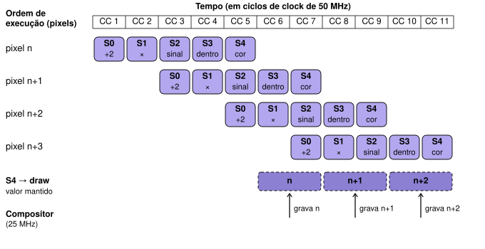
    <figcaption>
      <i>Figura 1 - Diagrama temporal do pipeline do rasterizador.</i>
    </figcaption>
  </figure>
</div>

<br>

Observe a Figura 1 acima. Enquanto os estágios internos (`S0` a `S3`) processam os dados a **50 MHz** (20 ns por etapa), a saída final (`S4`) retém o resultado por 40 ns para acompanhar o ritmo do Compositor, que opera a 25 MHz e amostra a cor pronta nos instantes indicados pelas setas.

## 2.1.4. Unidade de Controle

O módulo Unidade de Controle atua como o cérebro do coprocessador gráfico. Ele implementa uma Máquina de Estados Finitos (FSM) síncrona responsável por orquestrar a busca de comandos na fila (FIFO), decodificar o <code>opcode</code> de 5 bits e gerar os pulsos de habilitação (*enables*) e o barramento de dados para as unidades funcionais (Motores de Background, Sprites e Polígonos).

### Estados da FSM

- <code>INIT</code>: Estado ocioso inicial em que a FSM aguarda a chegada de instruções. Permanece neste estado enquanto a fila estiver vazia (<code>fifo_empty = 1</code>). Assim que uma nova instrução é detectada, transita para <code>GET_INST</code>.
- <code>GET_INST</code>: Realiza a retirada da instrução do topo da FIFO ativando o sinal de *pop* (<code>exec_pop = 1</code>). A palavra de 32 bits presente na saída da fila é registrada internamente em instrucao.
- <code>EXEC</code>: Decodifica o <code>opcode</code> localizado nos bits menos significativos (<code>instrucao[4:0]</code>) e isola os operandos nos 27 bits superiores (<code>dados <= instrucao[31:5]</code>). Neste ciclo, ativa de forma exclusiva as linhas de controle do módulo de destino:
  - **Background**: ativa <code>bg_en</code> (<code>BSCROLL</code>) ou <code>bg_ram_en</code> (<code>BTILE</code>).
  - **Sprites**: gera os pulsos decodificados em <code>sprite_en</code> (<code>POSSP</code>, <code>ATSP</code>, <code>RGSP</code>) ou habilita a gravação na memória gráfica com <code>sprite_ram_en</code> (<code>WRSP</code>).
  - **Polígonos**: aciona as linhas de configuração <code>pol_en</code> (<code>ATPO</code>, <code>POSPO</code>, <code>TAMPO</code>, <code>CORPO</code>).
  - **Prioridade do Compositor**: atualiza o registrador prioridade a partir do bit 5 (<code>instrucao[5]</code>).
  - **Transição**: Se a instrução executada for um <code>NOOP</code> (<code>5'b00000</code>), transita para <code>WAIT</code>; caso contrário, se a fila ainda contiver comandos (<code>!fifo_empty</code>), retorna diretamente a <code>GET_INST</code> para manter vazão máxima contínua, ou volta para <code>INIT</code> caso a fila esvazie.  
  - **Limpeza de Status (<code>CLST</code>):** Nova instrução dedicada de controle que zera simultaneamente as flags persistentes de diagnóstico (`err_opcode <= 1'b0` e `wrn_param <= 1'b0`), permitindo ao software reiniciar o monitoramento de exceções entre testes ou fases sem precisar aplicar um *reset* global no hardware.  
- <code>WAIT</code>: Dedicado exclusivamente à instrução de fim de quadro (<code>NOOP</code>). A Unidade de Controle suspende o fluxo de processamento e aguarda a ocorrência da borda de descida do sinal de sincronismo vertical (<code>negedge vsync</code>). Essa pausa sincroniza o software com a taxa de atualização do monitor (60 Hz), garantindo que as modificações de cena sejam consolidadas durante o apagamento vertical. Ao detectar o evento de <code>VSYNC</code>, a FSM avança para buscar novos comandos ou repousar.

### Validação de Operandos, Flags Persistentes e Contador de Quadros

Além do roteamento de comandos, a Unidade de Controle incorpora circuitos dedicados de telemetria e proteção de hardware:

- **Detector de Parâmetros Fora de Faixa (`wrn_param`):** Verifica em paralelo se os operandos recebidos excedem os limites físicos da tela ou das memórias (como `X >= 320` ou `Y >= 240` em `POSSP`/`POSPO`/`TAMPO`, `scroll_x >= 40` ou `scroll_y >= 30` em `BSCROLL`, `tipo > 4` em `ATPO` e `addr >= 76.800` em `BTILE`). Quando um limite é violado, a flag `wrn_param` é elevada e mantida em nível lógico alto até que a instrução `CLST` seja executada. No caso específico do `BTILE`, além de sinalizar o *warning*, o pulso `bg_ram_en` é suprimido para impedir escrita fora dos limites da memória.  
- **Contador de Quadros em Hardware (`frame_counter`):** Registrador de 16 bits incrementado automaticamente a cada borda de descida do `vsync` (`vsync_negedge`), fornecendo uma base de tempo precisa em hardware para aferição de FPS e sincronismo da aplicação.

## 2.1.5. Fila de Instruções

O módulo FIFO atua como a interface primária de entrada de comandos entre o processador principal (ARM Cortex-A9 via registradores <code>PIO</code>/<code>MMIO</code>) e o pipeline gráfico em hardware. Ele combina um banco de armazenamento circular síncrono de 16 palavras com uma Máquina de Estados Finitos (FSM) de handshake de 4 vias (<code>valid</code>, <code>busy</code> e <code>done</code>), garantindo a transferência atômica de instruções sem perda de dados por diferença de clocks.

### Estados da FSM

- <code>HAVE_INST</code>: Estado de repouso inicial em que a <code>FIFO</code> mantém <code>done = 0</code> e aguarda uma requisição do HPS. Quando detecta <code>valid = 1</code> e a fila não está cheia (<code>!fifo_full</code>), ativa <code>busy = 1</code>, gera o pulso de escrita <code>wr_en = 1</code> e avança para <code>WRD_INST</code>.
- <code>WRD_INST</code>: Sinaliza a conclusão do ciclo de escrita física do dado na fila. A <code>FSM</code> desativa <code>busy = 0</code> e eleva <code>done = 1</code> para notificar o processador que o comando foi armazenado com sucesso, transitando no ciclo seguinte para <code>WAIT</code>.
- <code>WAIT</code>: Estado de trava síncrona. Mantém <code>done = 1</code> e suspende novas operações até que o processador reconheça a resposta e abaixe a linha de validação (<code>!valid</code>). Assim que o sinal de <code>valid</code> é desassertado, a <code>FSM</code> zera <code>done = 0</code> e retorna para <code>HAVE_INST</code>, ficando pronta para o próximo envio.

### Mecanismo de Fila Circular e Ponteiros

- <code>sp</code> (Ponteiro de Escrita): Aponta para a posição da memória onde a próxima instrução vinda do barramento (<code>instr_in</code>) será gravada. Incrementa a cada escrita válida (<code>sp <= sp + 1</code>), retornando automaticamente ao início após a posição 15\.
- <code>exec</code> (Ponteiro de Leitura): Aponta para a instrução a ser consumida pela Unidade de Controle. Disponibiliza o dado continuamente na saída através de <code>instr_out = fila[exec]</code> e é incrementado sempre que a UC emite o pulso de retirada (pop) (<code>exec_pop = 1</code>).
- <code>count</code> (Contador de Ocupação): Registrador de 5 bits que monitora o saldo de instruções armazenadas para resolver condições de ambiguidade:
  - Ativa <code>fifo_empty = 1</code> quando <code>count == 0</code>, sinalizando para a Unidade de Controle que não há instruções pendentes.
  - Ativa <code>fifo_full = 1</code> quando <code>count == 16</code>, aplicando contrapressão (backpressure) sobre o HPS para impedir sobreescrita (overflow).
  - Trata inserções simultâneas de escrita e leitura em um mesmo ciclo de clock, mantendo o valor de <code>count</code> estável sem corrupção dos ponteiros.

## 2.1.6. ISA (Instruction Set Architecture)

A ISA personalizada define o conjunto de instruções de 32 bits suportadas pelo coprocessador. Cada instrução possui um campo de <code>opcode</code> dedicado, seguido dos seus operandos. Os parâmetros empacotados nas instruções representam valores imediatos que alimentam diretamente os registradores internos e controladores de memória:

- <code>X</code> e <code>Y</code> (Posição / Deslocamento): Coordenadas espaciais na tela. Para sprites e polígonos, <code>X</code> possui 9 bits (0 a 319\) e <code>Y</code> possui 8 bits (0 a 239). No caso de rolagem do plano de fundo (<code>BSCROLL</code>), representam o deslocamento matricial em unidades de tiles de 8x8 pixels (X de 0 a 39 e Y de 0 a 29).
- <code>COD RAM</code> (Endereçamento de Memória):
  - Em <code>BTILE</code> (11 bits, <code>[23:13]</code>): Endereço linear de uma das 1.200 posições da memória do mapa de tiles (0 a 1199), calculado por <code>Linha * 40 + Coluna</code>.
  - Em <code>WRSP</code> (13 bits, <code>[25:13]</code>): Endereço físico da memória de sprites de 8.192 posições (0 a 8191), cobrindo 32 slots de 256 pixels cada (<code>Slot * 256 + Y * 16 + X</code>).
- <code>cor</code> (Índice de Cor): Valor de 8 bits (0 a 255\) codificado no padrão RGB332 (<code>RRRGGGBB</code>). Para sprites e polígonos, o valor <code>0x00</code> atua como transparência.
- <code>ID REG</code> (Identificador do Registrador / Prioridade Fixa): Índice do banco de registradores de destino.
  - Nos sprites, aloca 5 bits (<code>[26:22]</code>, <code>[12:8]</code> ou <code>[14:10]</code>) para selecionar um dos 32 registradores (0 a 31). A posição no banco dita a prioridade estática: o registrador 0 possui a maior prioridade de desenho, sobrepondo o registrador 1, este sobrepondo o 2, até o registrador 31\.
  - Nos polígonos, aloca 4 bits (<code>[25:22]</code>, <code>[20:17]</code> ou <code>[16:13]</code>) para selecionar um dos 16 registradores (0 a 15). Assim como nos sprites, o polígono 0 possui a maior prioridade em caso de sobreposição geométrica.
- <code>ID RAM</code> (Identificador do Slot de Sprite): Campo de 5 bits (<code>[9:5]</code>) presente na instrução <code>RGSP</code> que seleciona qual padrão gráfico (dentre os 32 slots de 16x16 pixels armazenados na RAM) será vinculado ao registrador indicado por <code>ID REG</code>. Esse mecanismo desacopla o desenho armazenado da sua prioridade em tela.
- <code>flip</code> (Espelhamento do Sprite): Campo de 2 bits que controla a inversão dos eixos na leitura da memória do sprite:
  - <code>00</code>: Imagem normal.
  - <code>01</code>: Espelhamento vertical (flip V).
  - <code>10</code>: Espelhamento horizontal (flip H).
  - <code>11</code>: Espelhamento simultâneo horizontal e vertical.
- <code>shw</code> (Habilitação de Visibilidade): Bit único (<code>1</code> para visível e <code>0</code> para oculto).
- <code>tipo</code> (Geometria do Polígono): Campo de 3 bits (<code>[7:5]</code>) que seleciona o algoritmo de rasterização por equações de aresta:
  - <code>0</code>: Retângulo;
  - <code>1</code>: Quadrado;
  - <code>2</code>: Triângulo Equilátero;
  - <code>3</code>: Triângulo Isósceles;
  - <code>4</code>: Triângulo Escaleno / Retângulo;
- <code>pri</code> (Prioridade de Camadas): Bit único que orienta o circuito combinacional do Compositor:
  - <code>0</code>: Sprites possuem prioridade sobre os polígonos.
  - <code>1</code>: Polígonos possuem prioridade sobre os sprites.
- <code>clr</code> (Limpar): Bit único que faz a Unidade de Controle zerar as flags <code>err_opcode</code> e <code>wrn_param</code> da saída de status.

No total, tem-se 13 instruções que estão representadas abaixo:

<div align="center">
  <figure>
    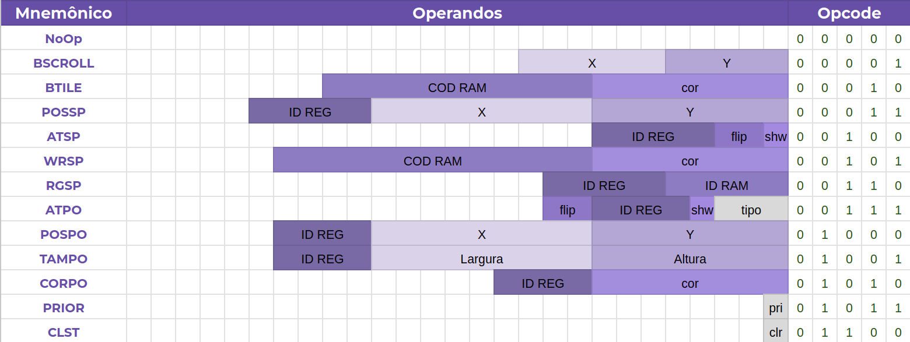
    <figcaption>
      <i>Figura 2 - Instruções do Coprocessador.</i>
    </figcaption>
  </figure>
</div>

<br>

## 2.1.7. Compositor de Camadas

O módulo Compositor atua como a unidade de varredura lógica, arbitração de camadas e alimentação contínua do Back Buffer. Ele desacopla a geração da imagem da leitura física do monitor, percorrendo autonomamente os 76.800 pixels da resolução de 320x240 no domínio de clock de 25 MHz (<code>clk25</code>) e selecionando a cor final de cada coordenada com base na prioridade configurada e na transparência.

### Estrutura e Funcionamento

- **Varredor Virtual de Resolução Lógica:**

  - Implementa dois contadores síncronos internos: <code>count_x</code> (9 bits, variando de 0 a 319\) e <code>count_y</code> (8 bits, variando de 0 a 239).
  - Ao atingir o limite horizontal (<code>count_x == 9'd319</code>), <code>count_x</code> é reiniciado em 0 e a linha vertical (<code>count_y</code>) é incrementada. Ao alcançar a última linha (<code>count_y == 8'd239</code>), o quadro reinicia em zero.
  - Os valores dos contadores são exportados continuamente nos barramentos de saída <code>scan_x</code> e <code>scan_y</code>, guiando os três motores gráficos (<code>MotorBG</code>, <code>MotorSprites</code> e <code>rasterizadorPoligonos</code>) na avaliação de suas respectivas geometrias para o pixel corrente.  
- **Cálculo de Endereçamento do FrameBuffer:**

  - Converte as coordenadas bidimensionais da varredura em um endereço linear de 17 bits (<code>current_addr</code>) por meio da equação combinacional <code>(count_y * 17'd320) + count_x</code>.
  - O endereço calculado é mapeado na porta de saída <code>fb_write_addr</code>, indexando linearmente a memória de 0 a 76.799.  
- **Multiplexação de Camadas, Transparência e Prioridade:**

  - Amostra concorrentemente as saídas de cor dos três motores: <code>draw_bg</code> (plano de fundo), <code>draw_sprites</code> (camada de sprites) e <code>draw_pol</code> (polígonos rasterizados).
  - O índice de cor <code>8'd0</code> (<code>0x00</code>) é tratado como transparente para sprites e polígonos, permitindo que a camada subjacente permaneça visível.
  - A seleção da cor final (<code>sel_cor</code>) é orientada pelo bit de controle <code>prioridade</code> (vindo da instrução <code>PRIOR</code> da ISA):
    - Prioridade Padrão (<code>prioridade == 0</code>): Sprites \> Polígonos \> Background. Se <code>draw_sprites != 8'd0</code>, a cor do sprite é exibida; caso contrário, se <code>draw_pol != 8'd0</code>, exibe o polígono; caso nenhum elemento ativo intercepte a coordenada, exibe <code>draw_bg</code>.
    - Prioridade Invertida (<code>prioridade == 1</code>): Polígonos \> Sprites \> Background. Se <code>draw_pol != 8'd0</code>, a cor do polígono se sobrepõe ao sprite; caso contrário, se <code>draw_sprites != 8'd0</code>, exibe o sprite; se ambos forem nulos, exibe <code>draw_bg</code>.

## 2.1.8. Top-Level

O módulo Top-level integra e conecta todos os subsistemas do coprocessador:

- Conecta a recepção de instruções (via FIFO) à Unidade de Controle;  
- Roteia os barramentos de registradores da Unidade de Controle para os Motores Gráficos;  
- Interliga a saída combinada do Compositor aos FrameBuffers e sincroniza a leitura do Front Buffer com o Driver VGA.  
- Gerencia os domínios de clock através do divisor de frequência, garantindo que o sinal base de 25 MHz alimente o sincronismo VGA, o varredor lógico e o controle síncrono das memórias M10K.

## 2.1.9. Endereço VGA

O Endereço VGA é um módulo simples responsável pelo cálculo do endereço a ser lido no Front Buffer.

- Recebe as coordenadas reais do VGA;  
- Redimensiona a área lógica de trabalho de 640x480 para 320x240;  
- Calcula o endereço da memória RAM do Front Buffer.

## 2.1.10. Buffers de Vídeo

O sistema adota uma arquitetura de Double Buffering (Front Buffer e Back Buffer) implementada em memórias Block RAM de duas portas (Dual-Port BRAM) para evitar tearing (corte de tela) e oscilações de imagem:

- **Back Buffer**: É a memória de destino de escrita contínua. A saída do Compositor é gravada nele à medida que o Varredor Lógico Interno processa os pixels (320x240);  
- **Front Buffer**: É a memória de destino de leitura exclusiva do Driver VGA;  
- **Alternância de Buffers**: A troca dos papéis de Front e Back Buffer ocorre exatamente no pulso de descida do sinal de sincronismo vertical (<code>VGA_VS</code>), durante o intervalo de apagamento vertical, garantindo que apenas quadros totalmente renderizados sejam exibidos na tela.

# 2.2. Diagrama de Alto Nível

A Figura 2 abaixo apresenta a arquitetura do projeto estruturada em um Diagrama de Alto Nível.

<div align="center">
  <figure>
    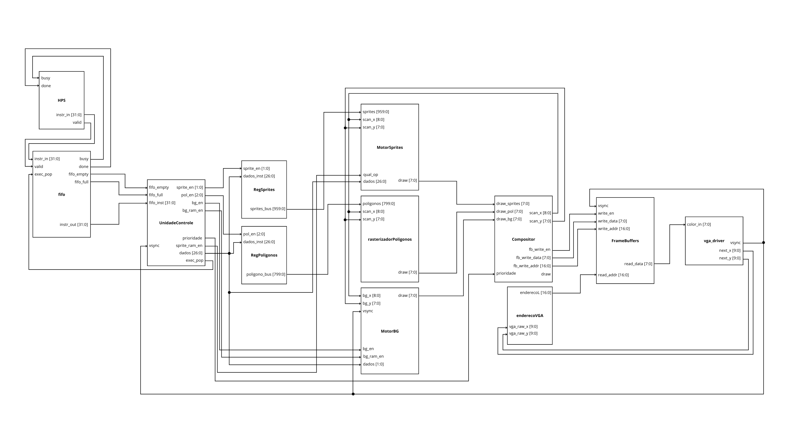
    <figcaption>
      <i>Figura 3 - Diagrama de Alto Nível da Arquitetura do Coprocessador e interface com HPS.</i>
    </figcaption>
  </figure>
</div>

<br>

# 2.3 Mapeamento de Memória (MMIO) e Entradas/Saídas Paralelas (PIOs)

A comunicação física entre o **HPS (Hard Processor System — ARM Cortex-A9)** e o coprocessador gráfico implementado ocorre por meio da ponte **Lightweight HPS-to-FPGA AXI Master**, configurada no **Platform Designer (Qsys)**. Esse barramento mapeia os sinais de controle e dados do coprocessador diretamente no espaço de endereçamento físico do processador (Memory-Mapped I/O — `MMIO`) a partir do endereço base **`0xFF200000`**.

## 2.3.1. Estruturação e Endereçamento dos PIOs no Platform Designer

Para isolar o barramento de instruções, os sinais de sincronismo de entrada e o barramento de telemetria de retorno, foram instanciados **cinco módulos Parallel I/O (`PIO`)** no *Platform Designer*, conectados à ponte `h2f_lw_axi_master` e exportados para o top-level:

| Componente IP (Qsys) | Porta Exportada (`ghrd_top.v`) | Direção (HPS $\leftrightarrow$ FPGA) | Largura | Offset de Endereço | Endereço Físico | Função na Arquitetura |
| :---- | :---- | :---: | :---: | :---: | :---: | :---- |
| **`pio_instrucao`** | `pio_instrucao_external_export` | Saída (`HPS` $\rightarrow$ `FPGA`) | 32 bits | `0x00000` | `0xFF200000` | Transporta a palavra de instrução de 32 bits codificada conforme a ISA (`operandos[31:5]` \+ `opcode[4:0]`) até a entrada `instr_in` da `FIFO`. |
| **`pio_busy`** | `pio_busy_external_export` | Entrada (`FPGA` $\rightarrow$ `HPS`) | 1 bit | `0x30000` | `0xFF230000` | Sinaliza ao HPS que a interface da `FIFO` está no meio de uma captura física de dado. |
| **`pio_done`** | `pio_done_external_export` | Entrada (`FPGA` $\rightarrow$ `HPS`) | 1 bit | `0x40000` | `0xFF240000` | Confirmação gerada pela FSM da `FIFO` indicando que a instrução foi armazenada com sucesso na fila. |
| **`pio_valid`** | `pio_valid_external_export` | Saída (`HPS` $\rightarrow$ `FPGA`) | 1 bit | `0x50000` | `0xFF250000` | Requisitar a gravação da palavra presente em `pio_instrucao`. |
| **`pio_status`** | `pio_status_external_export` | Entrada (`FPGA` $\rightarrow$ `HPS`) | 32 bits | `0x60000` | `0xFF260000` | Registrador de telemetria e diagnóstico que exporta em tempo real as flags da `FIFO`, exceções da Unidade de Controle e o contador de quadros (`frame_counter`). |

## 2.3.2. Mapeamento de Bits do Registrador de Status (`pio_status`)

O registrador `pio_status` (`0x60000`) consolida 32 bits de telemetria provenientes da `FIFO` e da `UnidadeControle` para monitoramento contínuo pela camada de aplicação:

| Faixa de Bits | Sinal de Hardware | Origem | Descrição Funcional |
| :---: | :---- | :---- | :---- |
| **`[0]`** | `fifo_full` | `FIFO` | Indica saturação da fila circular (`count == 16`), sinalizando que novas escritas serão retidas até a liberação de espaço. |
| **`[1]`** | `fifo_empty` | `FIFO` | Indica que a fila de comandos está completamente vazia (`count == 0`) e o coprocessador encontra-se ocioso. |
| **`[2]`** | `err_opcode` | `UnidadeControle` | Flag elevada quando um `opcode` inválido é decodificado no estado `EXEC` (limpa via instrução `CLST`). |
| **`[3]`** | `wrn_param` | `UnidadeControle` | Flag elevada quando parâmetros excedem os limites físicos de tela ou memória (limpa via instrução `CLST`). |
| **`[15:4]`** | *Reservado* | — | Bits reservados para expansões futuras de telemetria (`0`). |
| **`[31:16]`** | `frame_counter[15:0]` | `UnidadeControle` | Contador de 16 bits incrementado a cada borda de descida do sincronismo vertical (`vsync_negedge`), utilizado para sincronismo temporal e aferição de FPS. |

## 2.3.3. Protocolo de Handshake

Como o processador ARM (operando na faixa de 800 MHz sob escalonamento do kernel Linux) e o coprocessador gráfico (operando no domínio síncrono de 50 MHz da FPGA) possuem clocks assíncronos e latências de barramento distintas, o envio direto de um pulso simples em `pio_valid` faria com que a `FIFO` capturasse a mesma instrução dezenas de vezes consecutivas.

Para garantir a transferência atômica de exatamente **uma instrução por requisição**, a interface de entrada implementa um **protocolo de handshake completo de 4 fases (`valid` / `busy` / `done`)** controlado pela FSM da `FIFO`:

1. **Disponibilização do Dado:** O HPS escreve a palavra de 32 bits no registrador `pio_instrucao` (`0x00000`) e garante a estabilização física do barramento AXI antes de prosseguir.  
2. **Requisição (`valid = 1`):** O HPS asserciona a linha `pio_valid` (`0x50000`) em nível lógico alto. Na FPGA, a FSM da `FIFO` (no estado `HAVE_INST`) detecta `valid == 1` e verifica se há espaço disponível (`!fifo_full`), ativando `busy = 1` e disparando um pulso interno de escrita (`wr_en`) de **exatamente 1 ciclo de clock (20 ns)**.  
3. **Confirmação de Escrita (`done = 1`):** Concluída a gravação física na memória circular (estado `WRD_INST`), a FPGA desativa `busy = 0`, eleva `done = 1` no registrador `pio_done` (`0x40000`) e entra no estado de trava `WAIT`.  
4. **Encerramento do Ciclo (`valid = 0` $\rightarrow$ `done = 0`):** Ao ler `done == 1`, o HPS derruba `pio_valid` para `0`. A `FIFO` reconhece a desasserção (`!valid`), limpa `done` para `0` e retorna ao estado inicial `HAVE_INST`, liberando o barramento para a próxima instrução sem risco de duplicação ou sobrescrita.

# 2.4. Justificativa das Alterações Arquiteturais

1. **Retorno da Memória de Background para Endereçamento por Pixel (76.800 bytes) mantendo Rolagem em Blocos:** Anteriormente, a memória de background possuía apenas 1.200 posições ($40\times 30$), onde cada célula de $8\times 8$ pixels recebia uma única cor sólida de 8 bits. Isso inviabilizava a exibição de cenários artísticos detalhados, telas de título ilustradas e texturas complexas. Expandimos a `ram_map` para **76.800 palavras de 8 bits** ($320\times 240$), permitindo que a instrução `BTILE` pinte qualquer pixel individualmente. Ao mesmo tempo, mantivemos a lógica da instrução `BSCROLL` operando sobre fatias de blocos de $8\times 8$ pixels com *wrap-around* circular no `MotorBG`. Com isso, o jogo mantém o mapa lógico estruturado em uma grade de $40\times 30$ tiles para colisões e rolagem rápida de câmera, mas exibe gráficos com resolução de pixel completa.

2. **Implementação de Flip Direcional nos Polígonos (`ATPO`):** Na mecânica do jogo, os obstáculos de espinhos (triângulos) precisam apontar para as quatro direções (fixados no chão, no teto, na parede esquerda ou na parede direita). Na versão anterior, os triângulos só podiam apontar para cima. Aproveitou-se bits livres na palavra de 50 bits do banco `RegPoligonos` (`bits[47:46]`) e na instrução `ATPO` (`bits[14:13]`) para codificar 4 orientações (`00` \= Cima $\uparrow$, `01` \= Baixo $\downarrow$, `10` \= Direita $\rightarrow$, `11` \= Esquerda $\leftarrow$). Os vértices $A$, $B$ e $C$ são recalculados dentro da própria *bounding box* de largura $W$ e altura $H$, de modo que a caixa de colisão em C permanece idêntica independentemente da direção para a qual o espinho aponta.

3. **Pipelining de 5 Estágios e Lookahead no Rasterizador de Polígonos:** A adição do cálculo dinâmico dos 3 vértices ($A,B,C$) em função do `tipo` e do `flip` antes dos 96 multiplicadores vetoriais aumentou o atraso de propagação combinacional para $\sim 25,8\text{ ns}$, violando o *timing* do clock de 50 MHz ($20\text{ ns}$, *slack* de $-5,85\text{ ns}$) e gerando linhas corrompidas no monitor VGA. Desaclopou-se o cálculo dos vértices (que passou a ser registrado estaticamente apenas quando uma instrução altera o polígono) e fatiamento do caminho crítico de avaliação por pixel em **5 estágios de pipeline (`S0` a `S4`)**. Para compensar a latência adicional de 2 ciclos do clock de 25 MHz introduzida pelo pipeline, implementamos o **Lookahead de 2 pixels** (`next_x + 2`) no estágio `S0`, restaurando o *slack* positivo e eliminando 100% dos problemas visuais no VGA.

# 2.5. Recursos Utilizados na FPGA (Síntese Quartus Prime)

A síntese completa do SoC (integrando a ponte HPS, barramentos Qsys, fila FIFO, Unidade de Controle, Motores Gráficos, Rasterizador em Pipeline e triplo buffer de memória para Background \+ Double Framebuffer) no dispositivo **Cyclone V SoC (`5CSEMA5F31C6`)** apresentou a seguinte utilização de recursos de hardware:

## 2.5.1. Ocupação Global de Recursos

| Recurso da FPGA (Cyclone V `5CSEMA5F31C6`) | Utilizado no Projeto | Disponível no Dispositivo | Percentual de Ocupação | Distribuição por Subsistema |
| :---- | :---: | :---: | :---: | :---- |
| **Unidades Lógicas Adaptativas (ALMs)** | **9.957** | 32.070 | **31,0%** | • Coprocessador (`main` \+ `vga_driver`): \~6.750 ALMs<br>• Interconexão AXI/Qsys (`soc_system`): \~3.200 ALMs |
| **Registradores Dedicados (Flip-Flops)** | **7.710** | — | — | • Pipeline de polígonos (5 estágios): 5.281 regs<br>• Bancos `RegSprites` e `RegPoligonos`: 1.600 regs<br>• Controle, FIFO, VGA e Qsys: 829 regs |
| **Blocos Multiplicadores (DSP Blocks)** | **87** | **87** | **100,0%** | • Alocados integralmente no `rasterizadorPoligonos` para o cálculo paralelo das equações de semiplano dos 16 polígonos no estágio `S1`. |
| **Memória Interna em Blocos (M10K BRAM)** | **2.435.552 bits** *(\~297,3 KB)* | 4.065.280 bits | **60,0%** | • **Coprocessador (`main`):** **1.909.216 bits** (\~233 KB)<br>• **Sistema HPS/Qsys (`soc_system`):** **526.336 bits** (\~64,2 KB) |

## 2.5.2. Detalhamento por Módulo do Coprocessador Gráfico

A tabela abaixo isola o custo de área e memória de cada módulo customizado em Verilog que compõe o pipeline gráfico:

| Módulo | Lógica Combinacional (ALUTs) | Registradores | Memória M10K (Bits) | Blocos DSP | Função na Hierarquia |
| :---- | :---: | :---: | :---: | :---: | :---- |
| **`rasterizadorPoligonos:polig`** | 7.930 *(6.774 próprios)* | 5.281 | 0 | **87** | Pipeline de 5 estágios para avaliação vetorial de 16 polígonos simultâneos. |
| **`MotorSprites:sp`** | 1.385 | 23 | **65.536** | 0 | Teste paralelo de 32 sprites, *flip* H/V e memória `ram_sprites` ($8.192 \times 8\text{ bits}$). |
| **`RegPoligonos:regP`** | 805 | 768 | 0 | 0 | Banco de 16 registradores de polígonos (48 bits úteis por figura). |
| **`RegSprites:regS`** | 728 | 832 | 0 | 0 | Banco de 32 registradores de sprites (26 bits úteis por sprite). |
| **`vga_driver:vga`** | 112 | 39 | 0 | 0 | Temporização VGA $640\times 480$ @ 60 Hz e expansão RGB332 $\rightarrow$ RGB888. |
| **`Compositor:comp`** | 77 | 43 | 0 | 0 | Varredor lógico ($320\times 240$), compensação de latência e multiplexação de camadas. |
| **`fifo:fifo`** | 59 | 89 | **480** | 0 | Fila circular síncrona de 16 palavras $\times$ 32 bits e FSM de *handshake* de 4 fases. |
| **`MotorBG:bg`** | 55 | 52 | **614.400** | 0 | Rolagem circular em blocos de $8\times 8$ e memória `ram_map` ($76.800 \times 8\text{ bits}$). |
| **`UnidadeControle:uc`** | 49 | 87 | 0 | 0 | FSM de decodificação da ISA, validação de limites (`wrn_param`/`err_opcode`) e `frame_counter`. |
| **`FrameBuffers:buffers`** | 44 | 5 | **1.228.800** | 0 | Double Buffering em memórias Dual-Port (`buffer_A` e `buffer_B`, $2 \times 614.400\text{ bits}$). |
| **`enderecoVGA:addr`** | 29 | 0 | 0 | 0 | Escalonamento espacial $640\times 480\rightarrow 320\times 240$ e endereçamento do *Front Buffer*. |

> **Composição da Memória (2.435.552 bits):** Os **1.909.216 bits** do coprocessador correspondem à soma exata dos buffers de vídeo de tela cheia (`buffer_A` \+ `buffer_B` \+ `ram_map` \= $3 \times 614.400 = 1.843.200\text{ bits}$), da memória de sprites (`65.536 bits`) e da fila de instruções (`480 bits`). Os **526.336 bits** restantes pertencem à infraestrutura gerada pelo *Platform Designer* (`onchip_memory2_0` com $524.288\text{ bits}$ e FIFOs de travessia das pontes AXI/JTAG com $2.048\text{ bits}$).

## 2.5.3. Análise Temporal (*Timing Analyzer*)

Após o particionamento do `rasterizadorPoligonos` em 5 estágios de pipeline e o pré-cálculo estático dos vértices, o projeto atingiu fechamento de *timing* com folga positiva (*slack* positivo) em todos os domínios de clock da FPGA:

| Domínio de Clock | Frequência Alvo | Período | Antes (Combinacional)<br>F<sub>max</sub> / Folga | Depois (Pipeline 5 Estágios)<br>F<sub>max</sub> / Folga | Impacto no Hardware |
| :---- | :---: | :---: | :---: | :---: | :---- |
| **`clock_50_2` (`CLOCK2_50`)** | 50,00 MHz | 20,00 ns | **38,69 MHz** *(25,85 ns)*<br>**Slack: `-5,85 ns` (Violação)** | **61,53 MHz** *(16,25 ns)*<br>**Slack: `+3,75 ns` (Fechado)** | Ganho de **\+59,0%** na frequência máxima; elimina amostragem instável nos DSPs e *glitches* no VGA. |
| **`clock_50_1` (`CLOCK_50`)** | 50,00 MHz | 20,00 ns | **91,65 MHz** *(10,91 ns)*<br>Slack: `+9,09 ns` | **88,91 MHz** *(11,25 ns)*<br>Slack: `+8,75 ns` | Clock da ponte *Lightweight HPS-to-FPGA* e barramentos Avalon-MM (estável em ambas). |
| **`clk25` (Derivado)** | 25,00 MHz | 40,00 ns | \> 38,69 MHz<br>Slack: `+14,15 ns` | \> 61,53 MHz<br>Slack: `+23,75 ns` | Clock de varredura do `Compositor` e temporização física do `vga_driver`. |

</details>

---

<details>
<summary><h2 id="3-driver"> 3. Driver Assembly</h2></summary

O driver em Assembly ARMv7-A (32 bits) implementa a camada de comunicação via MMIO entre o processador ARM Cortex-A9 (HPS) e o coprocessador gráfico na FPGA.

# 3.1. Mapeamento de Memória (MMIO) 

O Linux executa as aplicações com memória virtual, então o driver não pode acessar diretamente o endereço físico da ponte Lightweight HPS-to-FPGA. Para isso, ele abre o dispositivo `/dev/mem` com as flags `O_RDWR` e `O_SYNC` e usa a syscall `mmap2` para mapear uma região de 2 MB a partir do endereço físico `0xFF200000`, armazenando o ponteiro virtual na variável global `ptr_base`. Como os PIOs são registradores de hardware, cujos valores podem mudar a qualquer momento por ação da FPGA, o acesso é feito sem passar pelo cache, de modo que cada leitura e escrita chega diretamente ao registrador e o processador não lê valores desatualizados. Cada PIO é acessado somando-se o seu *offset* (tabela da seção 2.3.1) ao ponteiro base.

# 3.2. Funções

O Driver em Assembly desenvolvido apresenta funções que controlam e monitoram o funcionamento do coprocessador e podem ser importadas para serem utilizadas em códigos de outras linguagens, como no caso do C. Essas funções podem ser divididas em quatro grupos principais:

- Funções de gerenciamento de ciclo de vida e mapeamento de memória;
- Funções de monitoramento de status e telemetria;
- Funções de codificação da ISA;
- Funções de comunicação e sincronização (handshake).

## 3.2.1. Funções de Gerenciamento de Ciclo de Vida e Mapeamento da Memória

As rotinas `gpu_init` e `gpu_close` são responsáveis por inicializar e encerrar a comunicação entre a FPGA e o espaço de usuário (Linux ARM), respectivamente.

| Função | Descrição |
|---|---|
| `gpu_init` | Prepara o ambiente de comunicação do processador ARM com a FPGA. Inicialmente, verifica se o ponteiro base já está mapeado. Caso não esteja, realiza o mapeamento de memória (seção 3.1). Por fim, garante que o sinal `PIO_VAL` seja inicializado em nível lógico baixo (0), retornando `0` em caso de sucesso ou `-1` em caso de falha. |
| `gpu_close` | Realiza o desmapeamento de memória através da syscall `munmap`, zera o ponteiro base e finaliza a comunicação de forma segura. |

## 3.2.2. Funções de Monitoramento de Status e Telemetria

Este grupo reúne rotinas para o monitoramento do hardware (leitura direta dos registradores PIO) e do estado mantido em software pelo próprio driver.

#### Leitura de registradores PIO

| Função | Registrador lido | Retorno |
|---|---|---|
| `status` | `PIO_STATUS` | Valor do registrador |
| `busy` | `PIO_BUSY` | Valor do registrador |
| `fifo_full` | `PIO_STATUS` | Bit 0 (sinal `fifo_full`) |
| `fifo_empty` | `PIO_STATUS` | Bit 1 (sinal `fifo_empty`) |
| `error` | `PIO_STATUS` | Bit 2 (sinal `err_opcode`) |
| `warning` | `PIO_STATUS` | Bit 3 (sinal `wrn_param`) |
| `frame_counter` | `PIO_STATUS` | 16 bits mais significativos (contador de frame) |


> Em qualquer uma dessas funções, caso a leitura do barramento `PIO_STATUS` falhe, elas retornam `-1`.

#### Funções sobre variáveis internas do driver

As três funções seguintes operam sobre variáveis internas do driver, evitando acessos extras ao barramento da FPGA:

| Função | Descrição |
|---|---|
| `obter_e_zerar_instrucoes` | Retorna a quantidade de instruções enviadas desde a última leitura e zera o contador. |
| `obter_mascara_sprites_ativos` | Retorna uma máscara de 32 bits, em que cada bit `1` corresponde a um sprite ativo. |
| `obter_mascara_poligonos_ativos` | Retorna uma máscara de 16 bits, em que cada bit `1` corresponde a um polígono ativo. |

## 3.2.3. Funções de Codificação da ISA

As funções deste grupo são responsáveis por organizar os parâmetros recebidos e empacotá-los junto ao opcode em uma palavra de 32 bits conforme a ISA do coprocessador antes de enviá-la para o coprocessador. Estas funções têm `0` como retorno em caso de sucesso e `-1` em caso de falha, valores definidos na função `enviar_instrucao`.

| Função | Instrução | Parâmetros | Observação |
|---|---|---|---|
| `clear_status` | `CLST` | — | — |
| `noop` | `NOOP` | — | — |
| `bscroll` | `BSCROLL` | Deslocamentos horizontal `x`, Deslocamentos vertical `y` | — |
| `btile` | `BTILE` | Endereço de memória `end`, Cor do pixel do tile `cor` | — |
| `possp` | `POSSP` | ID do sprite `id`, Posição horizontal `x`, Posição vertical `y` | — | 
| `atsp` | `ATSP` |  ID do sprite `id`, Condição de flip `flip`, Condição de visibilidade `show` | Atualiza a máscara de sprites ativos |
| `wrsp` | `WRSP` | Endereço de memória `end`, Cor do pixel do sprite `cor` | — |
| `rgsp` | `RGSP` | ID do sprite `id`, Slot de memória `slot` | — |
| `atpo` | `ATPO` | Condição de flip `flip`, ID do polígono`id`, Condição de visibilidade `show`, Tipo de polígno `tipo` | Atualiza a máscara de polígonos ativos |
| `tampo` | `TAMPO` | ID do polígono `id`, Largura `larg`, Altura `alt` | — |
| `pospo` | `POSPO` | ID do polígono `id`, Posição horizontal `x`, Posição vertical `y` | — |
| `corpo` | `CORPO` | ID do polígono `id`, Cor do polígono `cor` | — |
| `prior` | `PRIOR` |  Prioridade `p` | — |

> Essas rotinas realizam as ações definidas pela ISA.

## 3.2.4. Funções de Comunicação e Sincronização (Handshake)

A função `enviar_instrucao` é responsável por garantir o envio síncrono das instruções, implementando o protocolo Handshake em Assembly a partir do seguinte fluxo:

- Verificação: Certifica-se de que `gpu_init()` foi executada e que o coprocessador está disponível, ou seja , `PIO_BUSY` em nível lógico baixo;
- Escrita do Comando: O HPS escreve o dado vindo de uma das funções de codificação da ISA em `PIO_INST`;
- Barreira de Memória: Executa `dmb` e sobe a linha `PIO_VAL`; 
- Reconhecimento da FPGA: O hardware grava a instrução na FIFO e responde subindo `PIO_DONE`;
- Finalização: O HPS abaixa `PIO_VAL`, aguarda `PIO_DONE` retornar a zero para liberar a próxima chamada e atualiza o contador de instruções enviadas.

Esta função também possui um contador interno de timeout para evitar travamentos do sistema caso a placa seja resetada ou não responda.

# 3.3. Restrições de Uso

- **Acoplamento à ISA desenvolvida pela equipe:** o driver em Assembly contempla as instruções desenvolvidas pela equipe, portanto, a inclusão de novas instruções implica diretamente na modificação do driver.
- **Acoplamento ao sistema operacional Linux:** o driver em Assembly utiliza chamadas de sistema específicas do Linux, assim, ele pode não funcionar em outros SOs.
- **Não há suporte para multithreading:** as variáveis globais do driver não possuem mecanismos de exclusão mútua, fazendo com que erros ocorram caso mais de uma thread utilize o driver.
- **Limitação gerada pelo protocolo de handshake:** o envio de instruções depende do mecanismo de sincronização de 4 vias, limitando o envio de grandes volumes de dados, o que pode ser insuficiente para certas aplicações.

</details>

---

<details>
<summary><h2 id="4-threads"> 4. Threads</h2></summary>

A camada de aplicação do jogo é separada em duas threads, compartilhando recursos e comunicando-se com o coprocessador gráfico. Desse modo, este tópico busca explicar como as linhas de execução interagem com os recursos e entre si, evitando situações de concorrência e dessincronização.

# 4.1. Modelo de Execução Multithread

O jogo desenvolvido em C apresenta duas threads (linhas de execução), uma dedicada para execução do jogo e outra dedicada para leitura de eventos do teclado. A repartição da execução do programa deu-se devido ao fato de que o funcionamento de dispositivos de entrada e saída causam a parada da execução, ou seja, quando uma entrada é requisitada, o programa para até ler um valor do dispositivo. Assim, para que o jogo funcionasse continuamente com o teclado, foi necessário separar a execução em duas threads, possibilitando o fluxo contínuo do software e a leitura contínua do teclado.

Neste projeto, as threads funcionam em uma relação de **Produtor-Consumidor**, em que a thread do teclado é o produtor e a thread principal é o consumidor. Além disso, foi utilizada a biblioteca **Pthreads (POSIX Threads)**, que possui funções para gerenciamento e sincronização de threads, além de estruturas de dados e atributos para configuração das threads.

# 4.2. Thread Principal

A thread principal é a linha de execução do jogo, contendo o loop do jogo, a máquina de estados e a comunicação com o coprocessador. No código em C, esta thread não foi explicitamente declarada, mas é nela que há toda a organização dos componentes necessários para o funcionamento do jogo. Inicialmente, há a inicialização do coprocessador gráfico com o gpu_init e a criação da thread do teclado. Então, inicia-se o loop de execução do jogo. Nele, a máquina de estados gerencia a troca entre as telas e fases, desencadeada pelos eventos de entrada do teclado, calcula o tempo de cada frame e sincroniza a taxa de atualização do jogo em aproximadamente 60 FPS. 

A sincronização de quadro com o VSYNC via software em C ocorre com o envio de instruções `noop` após cada iteração do laço do jogo, assim, a fila de instruções fica cheia e apenas instruções do frame atual são executadas até o sinal do VSYNC. Destarte, a técnica de *Double Buffering* impede a geração de erros visuais, como o *screen tearing*, e, juntamente com o envio de instruções `noop` e a parada momentânea de execução da thread principal, asseguram a produção de frames a 60 Hz.

Ao final do jogo, todos os sprites e polígonos são ocultados, a comunicação com o coprocessador gráfico e a thread do teclado são finalizados com o `gpu_close` e `pthread_cancel`, respectivamente. Vale ressaltar que apenas a thread principal comunica-se com o driver em Assembly. Isso ocorre, pois evita condições de corrida e corrobora a função desta thread de gerenciar o jogo, tanto logicamente quanto graficamente, assegurando que os movimentos de sprites e polígonos respeitam as entradas do teclado e os limites do jogo.

# 4.3. Thread Dedicada de Entrada USB

A thread dedicada à entrada USB é responsável pela leitura dos eventos que ocorrem no teclado. As três principais estruturas dessa thread são:

- a estrutura estática `teclado` (`EstadoTeclado`), que armazena o estado atual das teclas monitoradas;
- a variável global `jogo_rodando`, que mantém os laços de execução ativos até o final do jogo;
- o mutex `mutex_teclado`, que controla o acesso à estrutura `teclado`.

 Inicialmente, a thread identifica o dispositivo de entrada correspondente ao teclado, obtendo os descritores de arquivo que possibilitam a comunicação entre o jogo e o teclado. Então, inicia-se o laço de leitura de eventos. Ao captar um evento do teclado, o mutex é bloqueado para atualização do estado da tecla pressionada e depois é desbloqueado. Caso um evento do teclado não seja identificado, a thread “dorme” por dois milissegundos, evitando desperdício de processamento da CPU.

É importante destacar que a abertura dos arquivos de dispositivo de entrada é feita no modo não bloqueante, permitindo que a thread não congele.

# 4.4. Sincronização entre Threads

Como já citado anteriormente, as threads desenvolvidas para este jogo funcionam em uma relação Produtor-Consumidor e utilizam um mutex para evitar incoerência de valores na estrutura estática compartilhada teclado. 

A thread do teclado é a produtora e aumenta os valores de teclado à medida que captura eventos do teclado, já a thread principal é a consumidora, consumindo os estados e limpando os disparos do teclado. Para que isso ocorra corretamente, a cada atualização dos valores de teclado, o mutex é bloqueado, sendo desbloqueado ao final da atualização. 

</details>

---

<div align="center">
  <figure>
    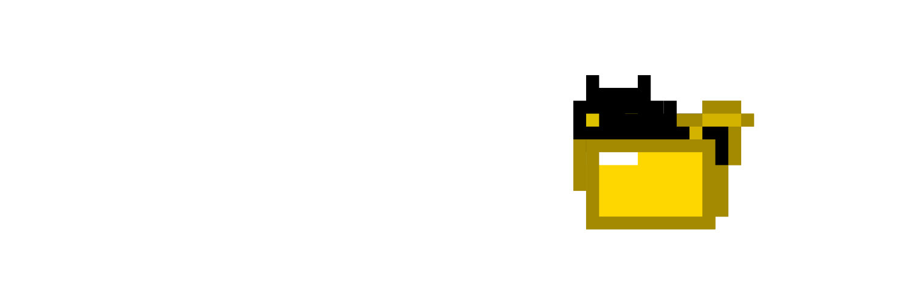
  </figure>
</div>

<details>
<summary><h2 id="5-jogo"> 5. Tomb of The Desk </h2></summary>

# 5.1. Fluxo de telas

O jogo é uma **máquina de estados** (`EstadoJogo`, em `jogo.h`) controlada pelo `switch` do laço principal em `main.c`. Cada estado carrega seus recursos uma única vez (flag `estado_iniciado`) e depois só atualiza animações.

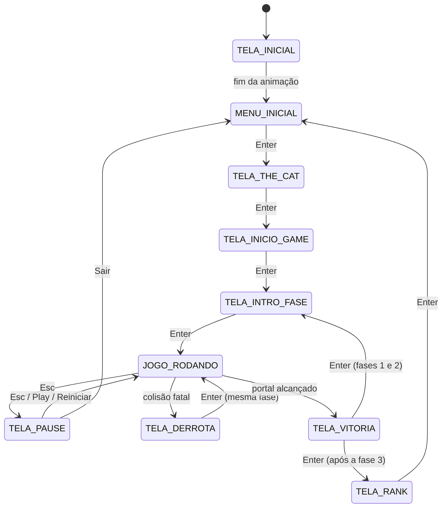

| Estado | O que aparece | Entrada |
|---|---|---|
| **Tela inicial** | O gato cai na pasta (`openFile`), a pasta abre e o gato aparece (~230 quadros) | Automática |
| **Menu** | Botão **PLAY** piscando e gato animado dentro do computador | `Enter` |
| **The Cat** | Escolha da skin entre os 3 gatos | `←` `→` / `A` `D` / `S`, confirma com `Enter` |
| **Início do game / Intro da fase** | Tela narrativa de cada fase (`fase01tela`, `fase02tela`, `fase03tela`) | `Enter` |
| **Jogo rodando** | Fase em andamento | `W A S D` / setas, `Espaço`, `Esc` |
| **Pausa** | Três botões: **Sair**, **Reiniciar** e **Play** | `←` `→` escolhe, `Enter` confirma, `Esc` volta |
| **Vitória** | Pontos da fase | `Enter` |
| **Derrota** | Pontos da tentativa | `Enter` (volta direto à fase, sem a intro) |
| **Ranking** | Top 3 com skin e pontos, mais a pontuação total da partida no canto esquerdo | `Enter` |

> **Atalho de depuração:** a tecla `P` avança imediatamente para a próxima tela/fase. Ela existe para testes e deve ser desativada na versão final.
A seguir, as principais telas do jogo, na ordem em que aparecem para o jogador.
<div align="center">
  <figure>
    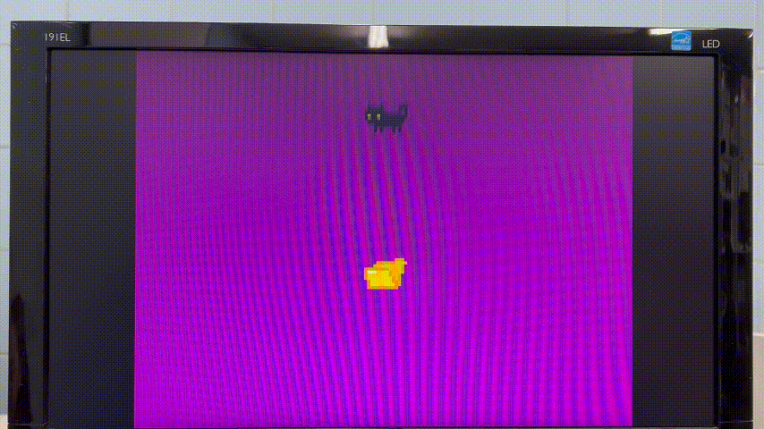
    <br>
    <figcaption>
      <i>Figura x - Tela inicial.</i>
    </figcaption>
  </figure>
</div>
<br>
A tela seguinte permite escolher a skin do gato que será usada em todas as fases.
<div align="center">
  <figure>
    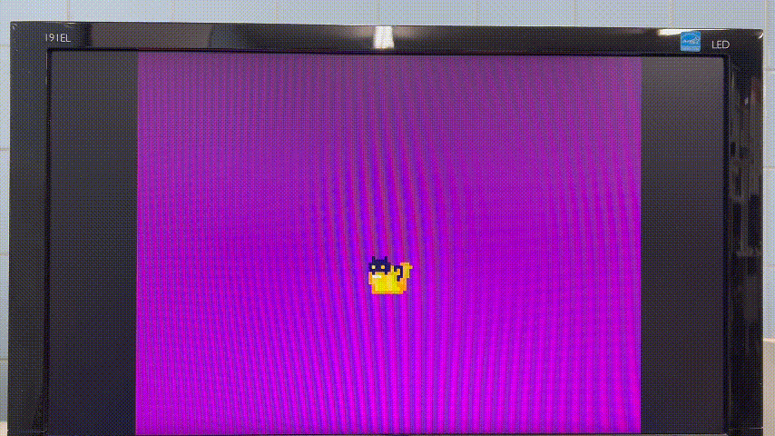
    <br>
    <figcaption>
      <i>Figura x - Menu inicial e escolha do personagem.</i>
    </figcaption>
  </figure>
</div>
<br>
Durante a partida, a tecla `Esc` abre a tela de pausa, com as opções de sair, reiniciar a fase ou continuar a fase de onde parou.
<div align="center">
  <figure>
    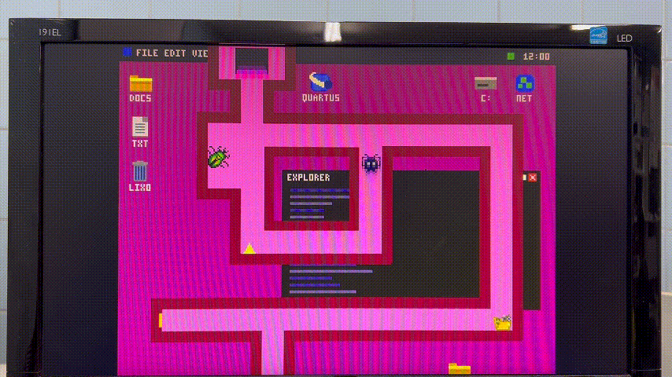
    <br>
    <figcaption>
      <i>Figura x - Tela de pausa funcionando.</i>
    </figcaption>
  </figure>
</div>
<br>

---

# 5.2. Mecânica de movimentação

A movimentação segue o estilo **Tomb of the Mask**: o gato **desliza continuamente** em uma direção até encontrar um obstáculo.

- **Entrada:** uma thread dedicada (`thread_teclado_usb`, em `threads.c`) lê os dispositivos `/dev/input/event*` e protege o estado do teclado com *mutex*. A lógica lê uma cópia por quadro com `ler_botoes_estado()`.
- **Nova direção só com o gato parado:** enquanto `g_vel_tx`/`g_vel_ty` forem diferentes de zero, novas direções são descartadas.
- **Passo de 8 px por quadro.** Se o próximo passo bateria em parede, o gato avança **pixel a pixel** até encostar e então para (`g_vel = 0`).
- **Segurar `Espaço`:** o gato fica parado e troca para o segundo quadro de sprite. Nesse estado, projéteis das aves são destruídos em vez de matar, e, na fase 3, as patrulhas não causam dano (ver [5.3](#53-colisões)).
- **Orientação:** o *flip* do sprite acompanha a direção (`g_flip_jogador`).
- **Rastro:** dois retângulos amarelos (polígonos 12 e 13) são desenhados atrás do gato enquanto ele desliza.
- **Câmera por etapas:** cada mapa tem 320×480 px, maior que a tela lógica (320×240). O mapa é dividido em duas metades: **etapa inferior** (Y 240–479, onde o gato começa) e **etapa superior** (Y 0–239). Ao cruzar Y = 240, `atualizar_etapa_camera()` recarrega o background (`carregar_etapa_fundo_ram()`, com 76.800 `btile`) e os objetos são multiplexados por metade.

---

# 5.3. Colisões

Todas as colisões usam **retângulos alinhados aos eixos (AABB)**, pela função `retangulos_colidem()`. O gato tem *hitbox* de 16×16 px.

| Colisão | Como funciona | Resultado |
|---|---|---|
| **Paredes** | Máscara de paredes de cada fase (`paredesF1/F2/F3`) convertida em grade de tiles 40×60 (`copiar_mascara_colisoes`); testa os 4 cantos do gato (`caixa_bate_em_parede`) | O gato para |
| **Espinhos (fixos e temporários ativos)** | *Hitbox* reduzida do gato (12×12, deslocada 2 px) contra o triângulo (9×7 ou 7×9) | **Morte** |
| **Projétil da ave** (3×3) | Colisão com o gato | **Morte**, ou o projétil é destruído se `Espaço` estiver segurado |
| **BotDog** (80×16) | Colisão com o corpo inteiro | **Morte** |
| **Patrulha** (16×16) | A patrulha avança 1 px por vez e para antes de sobrepor o gato, registrando o contato (`g_bateu_patrulha`) | **Morte** (na fase 3 não mata com `Espaço` segurado) |
| **Ave** (16×16) | Tratada como sólido: bloqueia o movimento | O gato para |
| **Bug** (16×16) | Sobreposição com o gato | **Coleta** (+700) |
| **Portal** (14×14) | Sobreposição com o gato | **Vitória** |

Ao morrer, `animar_morte_gato()` exibe a animação de fumaça (7 quadros) antes da tela de derrota.
Ao tocar em um elemento letal, o gato morre e aparece a tela de derrota.
<div align="center">
  <figure>
    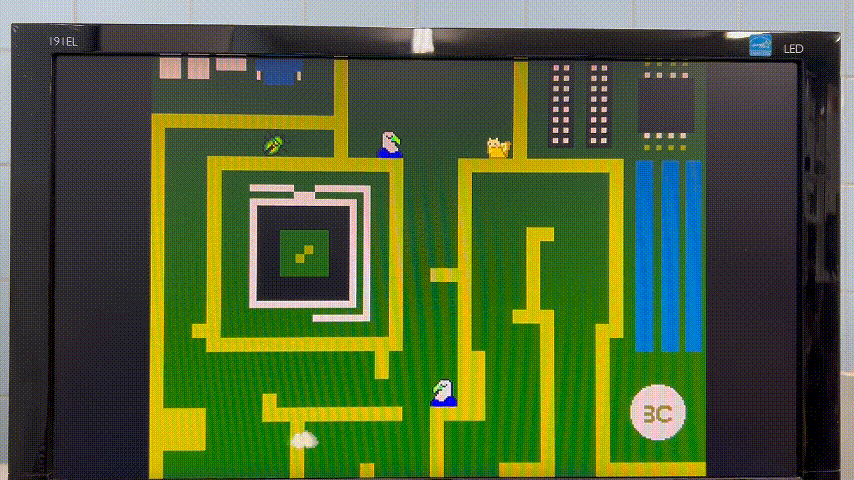
    <br>
    <figcaption>
      <i>Figura x - Tela de derrota.</i>
    </figcaption>
  </figure>
</div>
<br>


---

# 5.4. Entidades do jogo, comportamento e animação

| Entidade | Aparece em | Comportamento | Animação |
|---|---|---|---|
| **Gato** (jogador) | Todas | Desliza até bater em parede; `Espaço` o segura parado | 3 skins × 2 quadros; *flip* conforme a direção; rastro amarelo em polígonos |
| **Bug** | Todas (3 por fase) | Colecionável parado; vale +700 | 7 quadros de sprite; ao coletar, toca os quadros 1–6 (troca a cada 3 quadros) |
| **Espinho fixo** | Fase 1 | Triângulo sempre ativo e letal | Polígono triangular com *flip* nas 4 direções |
| **Espinho temporário** | Todas | Marcador no chão: ao ser tocado **arma** (1 s, pisca vermelho/amarelo), vira **espinho letal** (3 s) e depois volta a marcador | Retângulo vira triângulo (polígono com *flip*) |
| **Patrulha** | Todas | Percorre um circuito retangular a 2 px/quadro, em sentido horário ou anti-horário; pode matar o gato | Sprite com *flip* conforme a direção. Vírus do SO (F1), *Warning* do Quartus (F2), Bolha/nuvem de pipeline (F3) |
| **Ave robô** | Fase 3 (3 aves) | Atira a cada 2 s (120 quadros) **só quando o gato está na mesma metade do mapa**; o tiro (3×3, 5 px/quadro) some ao bater em parede | 3 quadros (olho fechado, olho aberto no último 0,5 s e atirando), recuo ao disparar e **explosão** crescente de 8 quadros |
| **BotDog** | Fases 2 e 3 (2 por fase) | Dispara quando o gato passa de determinada altura (`y_gatilho`) e atravessa a tela a 4 px/quadro, em um dos dois sentidos | Corpo de 5 sprites (80 px); 2 quadros alternando a cada 6 quadros |
| **Portal** | Todas | Ao ser tocado, encerra a fase | Quadrado de 13×13 (polígono 0); ao entrar, animação de brilho (5 quadros) |

---

# 5.5. As 3 fases

Cada fase é um mapa de **320×480 px** (duas telas empilhadas), com fundo, máscara de paredes e layout próprios, definidos em `configurar_layout_fase()` (`mapa.c`).

| | **Fase 1** | **Fase 2** | **Fase 3** |
|---|---|---|---|
| **Tema do inimigo** | Vírus do SO | *Warning* do Quartus | Bolha/nuvem de pipeline |
| **Espinhos temporários** | 5 | 12 | 12 |
| **Espinhos fixos** | 1 | — | — |
| **Patrulhas** | 1 | 2 | 2 |
| **BotDogs** | — | 2 | 2 |
| **Aves que atiram** | — | — | 3 |
| **Bugs** | 3 | 3 | 3 |
| **Início do gato (x, y)** | (136, 463) | (152, 463) | (13, 463) |
| **Portal (x, y)** | (89, 0) | (16, 21) | (154, 0) |
Veja cada fase em funcionamento na placa:
<div align="center">
  <figure>
    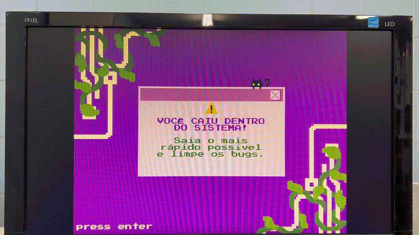
    <br>
    <figcaption>
      <i>Figura x - Fase 1 rodando.</i>
    </figcaption>
  </figure>
</div>
<br>
<div align="center">
  <figure>
    
    <br>
    <figcaption>
      <i>Figura x - Fase 2 rodando.</i>
    </figcaption>
  </figure>
</div>
<br>
<div align="center">
  <figure>
    
    <br>
    <figcaption>
      <i>Figura x - Fase 3 rodando.</i>
    </figcaption>
  </figure>
</div>
<br>

**Progressão:** a fase 1 apresenta o deslizamento, os espinhos que armam e uma patrulha. A fase 2 acrescenta o BotDog e mais espinhos. A fase 3 reúne tudo e adiciona as aves que atiram. Além disso, a pose de `Espaço` passa a neutralizar patrulhas.
<div align="center">
  <figure>
    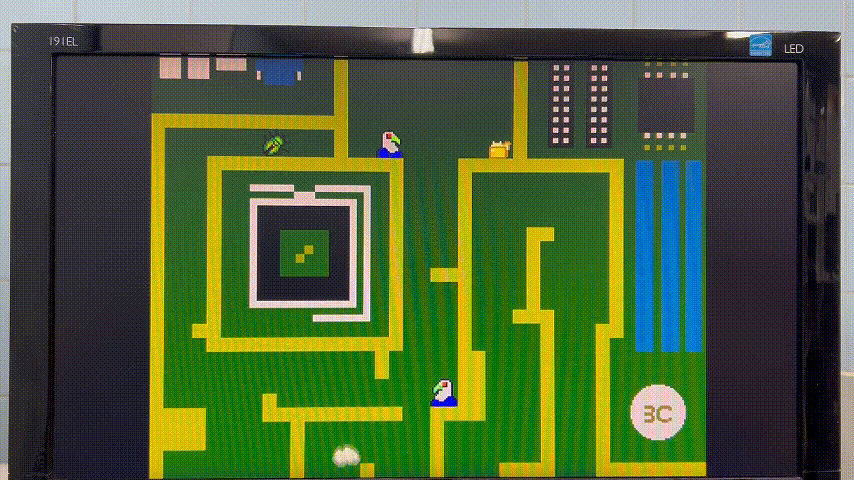
    <br>
    <figcaption>
      <i>Figura x - Jogador ativando proteção.</i>
    </figcaption>
  </figure>
</div>
<br>

**Evento especial da fase 3:** ao passar pelo ponto (144, 57), perto do portal, o **portal foge** para (235, 427) e o mapa troca de `mapa_fase3_1` para `mapa_fase3_2` (`portal_fugiu`). O jogador precisa voltar para alcançá-lo.
Ao final de cada fase caso o jogador ganhe ele vai para a tela de vitória abaixo:
<div align="center">
  <figure>
    
    <br>
    <figcaption>
      <i>Figura x - Tela de vitória.</i>
    </figcaption>
  </figure>
</div>
<br>
---

# 5.6. Como funciona a pontuação

| Item | Valor |
|---|---|
| **Bug coletado** | **+700** pontos |
| **Bônus de tempo** (ao vencer) | `650 / (1 + 0,04 × segundos)`, no máximo 650 (nunca supera um bug) |
| **Penalidade por morte** | **−220** por morte na fase |
| **Piso mínimo** | `pontos_dos_bugs − 150` (ou 50 se nenhum bug foi coletado) |

**Pontos da fase** = `(bugs × 700) + bônus_de_tempo − (mortes × 220)`, respeitado o piso mínimo.

- O cronômetro começa ao confirmar a tela de intro da fase e **não zera ao morrer**.
- Ao morrer, os bugs da tentativa são **repostos** e a tela de derrota mostra os pontos da tentativa já com a multa.
- A **pontuação total** é a soma das 3 fases (`g_pontos_totais`) e é exibida com 4 dígitos.
Ao concluir a fase 3, a pontuação é registrada e o Top 3 é exibido:
<div align="center">
  <figure>
    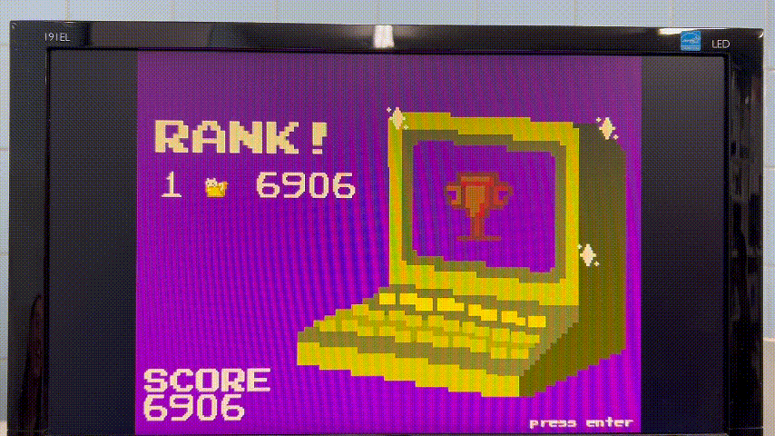
    <br>
    <figcaption>
      <i>Figura x - Tela do Top 3 melhores pontuações.</i>
    </figcaption>
  </figure>
</div>
<br>

---

# 5.7. Persistência de dados para o ranking

O **Top 3** é salvo em um arquivo binário, `ranking_tomb_of_the_mask.dat`, criado no diretório de execução. Cada registro é uma struct `RegistroRanking`:

```c
typedef struct {
    int pontos_totais;
    int skin_id;
    int valido;
} RegistroRanking;
```

| Etapa | Função (`metricas.c`) | O que faz |
|---|---|---|
| Início do programa | `carregar_ranking_arquivo()` | Lê o arquivo (`fread`), valida cada registro e ordena. Se não existir, o ranking começa vazio. Há também *fallback* para um arquivo de nome antigo |
| Fim da 3ª fase | `registrar_no_ranking()` | Insere a pontuação na posição correta, empurrando as demais para baixo |
| Após inserir | `salvar_ranking_arquivo()` | Reordena e grava os 3 registros (`fwrite`) |
| Tela de ranking | `carregar_tela_rank()` | Mostra posição, skin do gato e pontos (4 dígitos) de cada registro válido |

**Validação:** um registro só é aceito se `valido == 1`, os pontos estiverem entre 0 e 99.999.999 e a skin entre 0 e 2. Isso protege contra arquivo corrompido.

---

# 5.8. Funções empregadas

#### Driver Assembly (`libAssembly.S`), usadas pelo jogo

| Função | Descrição |
|---|---|
| `gpu_init()` / `gpu_close()` | Mapeia/libera o acesso MMIO ao coprocessador |
| `btile(end, cor)` | Escreve um pixel do background na RAM de vídeo |
| `bscroll(x, y)` | Define o deslocamento do background |
| `wrsp(end, cor)` | Escreve um pixel de um padrão de sprite na RAM de sprites |
| `rgsp(id, slot)` | Associa um sprite a um padrão da RAM |
| `possp(id, x, y)` / `atsp(id, flip, show)` | Posição e atributos do sprite (espelhamento, visibilidade) |
| `pospo(id, x, y)` / `tampo(id, larg, alt)` / `corpo(id, cor)` / `atpo(flip, id, show, tipo)` | Posição, tamanho, cor e tipo/atributos do polígono |
| `prior(p)` | Prioridade entre camadas |
| `noop()` | Fecha o quadro |
| `clear_status()` | Limpa as flags de erro e aviso |
| `status()`, `busy()`, `fifo_full()`, `fifo_empty()`, `error()`, `warning()`, `frame_counter()` | Consulta do estado do hardware |
| `obter_e_zerar_instrucoes()`, `obter_mascara_sprites_ativos()`, `obter_mascara_poligonos_ativos()` | Contadores e máscaras usados nas métricas |

#### Aplicação em C

| Arquivo | Funções principais |
|---|---|
| `main.c` | `main()`: laço principal, máquina de estados, cálculo da pontuação de cada fase |
| `logica_jogo.c` | `executar_estado_jogando()`, `checar_colisoes()`, `colisao_parede()`, `retangulos_colidem()`, `atualizar_ave_robo()`, `posicao_jogador_no_endgame()`, `colisao_ponto()` |
| `mapa.c` | `carregar_fase()`, `configurar_layout_fase()`, `carregar_fundo_etapa()`, `atualizar_etapa_camera()`, `atualizar_visuais_objetos_fase()`, `desenhar_ave_robo()`, `restaurar_cena_fase_atual()`, `copiar_mascara_colisoes()` |
| `telas.c` | `carregar_*` e `atualizar_*` de cada tela, `animar_morte_gato()`, `animar_entrada_porta()`, `exibir_numero_4_digitos()` |
| `threads.c` | `thread_teclado_usb()`, `ler_botoes_estado()`, `limpar_direcoes_teclado()` |
| `metricas.c` | `metricas_registrar_frame()` (FPS, CPU, latência por comando), `carregar_ranking_arquivo()`, `salvar_ranking_arquivo()`, `registrar_no_ranking()` |

</details>

---

<details>
<summary><h2 id="6-testes-e-analise"> 6. Testes e Análise de Desempenho</h2></summary>

A validação do sistema integrado foi conduzida diretamente na placa **DE1-SoC** por meio de duas frentes complementares de testes em tempo real:

1. **Teste Interativo Individualizado (`testeInstrucoes.c`):** Programa com menu interativo utilizado durante o desenvolvimento para validar manualmente o disparo isolado de cada função do driver Assembly (`libAssembly.S`), a resposta visual imediata no monitor VGA e o comportamento de retenção e limpeza das flags de status (`error` e `warning`).

2. **Validação Arquitetural e Estresse (`testeClaude.c`):** Uma bateria automatizada e interativa de **25 cenas** que submeteu o coprocessador a **8.383.369 instruções consecutivas**, aferindo com resolução de nanosegundos a latência de *handshake* MMIO, a precisão das flags de hardware, a retenção da `FIFO`, os limites geométricos da ISA e o orçamento máximo de instruções por quadro a 60 Hz.
   
3. **Telemetria em Tempo Real no Jogo (`metricas.c`):** Instrumentação acoplada ao *game loop* para monitorar o custo de renderização de cada estado do jogo (menus, transições de tela e fases jogáveis), o consumo percentual do orçamento de quadro de $16,67\text{ ms}$ e o impacto das decisões tomadas na fluidez de 60 FPS.

# 6.1. Teste Individualizado das Instruções e Resultado das Flags de Status

Antes de submeter o coprocessador às baterias automatizadas de estresse, utiliza-se o programa interativo `testeInstrucoes.c` para validar individualmente cada instrução da ISA e verificar a leitura das flags no registrador `PIO_STATUS` (`0xFF260000`) após cada envio.

Por meio de um menu em terminal, pode-se selecionar qualquer uma das 13 instruções válidas ou forçar o envio de uma palavra inválida (`0xFFFFFFFF`), exibindo imediatamente o valor em hexadecimal do registrador de status e os campos decodificados (`busy`, `fifo_full`, `fifo_empty`, `error`, `warning` e `frame_hw`).

```text
[STATUS APOS ENVIO] status=0x716B0002 | busy=0 | fifo_full=0 | fifo_empty=1 | error=0 | warning=0 | frame_hw=29035
``` 

# 6.2. Teste de Estresse no Coprocessador e Análise do Desempenho

Ao longo das **25 cenas**, foram executadas **470 verificações automatizadas**, encerrando com **100% de aprovação**.

## 6.2.1. Validação do Link MMIO, Semântica do Driver e Flags de Status (Cenas 01 a 10)

As dez primeiras cenas validaram a integridade da ponte *Lightweight HPS-to-FPGA*, o empacotamento de bits do driver Assembly e o comportamento das flags do registrador `PIO_STATUS` (`0xFF260000`):

| Cenas | Foco da Validação | Resultado Obtido no Hardware |
| :---: | :--- | :--- |
| **01 – 02** | **Link MMIO, `status()` e `busy()`** | Leituras MMIO com mediana de **`0,390 µs`** (`status`) e **`0,400 µs`** (`busy`); handshake completo custa **`2,270 µs`** ($\approx 6$ acessos MMIO); reinicialização (`gpu_close`/`gpu_init`) idempotente. |
| **03 – 04** | **Contador e Máscaras do Driver** | Contagem exata por opcode (`433.599 instr/s` em rajada); `0` divergências em 6.000 operações nas máscaras de ativos, reduzindo de 50 para **17 instruções** a limpeza de tela. |
| **05 – 07** | **VSYNC, `NOOP` e `FIFO` (16)** | Taxa estável de **`59,524 FPS`** (`16,800 ms`, *jitter* de `1,16 µs`); `FIFO` absorve **17 comandos** sem bloqueio e aplica *backpressure* até o `VSYNC`, drenando em **`3,7 µs`**. |
| **08 – 10** | **Flags (`wrn_param`, `err_opcode`), `CLST` e *Fuzzing*** | `59/59` limites de parâmetros e `19/19` opcodes inválidos (`13..31`) retidos corretamente e limpos via `CLST`; **`0` divergências** em 20.000 rajadas aleatórias. |

## 6.2.2. Perfilamento de Latência, Vazão Sustentada e Orçamento por Quadro (Cenas 11 a 13)

Na **Cena 11**, cada uma das 13 instruções da ISA (além do `NOOP` e de opcodes inválidos) foi disparada **5.000 vezes isoladamente** (totalizando 70.000 medições individuais) para mapear os percentis de tempo de resposta do protocolo de *handshake*:

| Instrução (Opcode) | Amostras ($N$) | Mín (`µs`) | Mediana `p50` (`µs`) | `p90` (`µs`) | `p99` (`µs`) | Máx (`µs`) | Média (`µs`) | Vazão Individual (`instr/s`) |
| :--- | :---: | :---: | :---: | :---: | :---: | :---: | :---: | :---: |
| **`noop (rápido)`** | 5.000 | 2,25 | **2,28** | 2,31 | 6,91 | 199,82 | 2,46 | **405.810** |
| **`bscroll`** | 5.000 | 2,27 | **2,31** | 2,33 | 6,94 | 23,61 | 2,44 | **409.388** |
| **`btile`** | 5.000 | 2,28 | **2,29** | 2,31 | 6,90 | 72,34 | 2,45 | **407.559** |
| **`possp`** | 5.000 | 2,28 | **2,31** | 2,33 | 6,93 | 61,76 | 2,46 | **406.111** |
| **`atsp`** | 5.000 | 2,28 | **2,32** | 2,34 | 6,96 | 79,70 | 2,47 | **404.952** |
| **`wrsp`** | 5.000 | 2,28 | **2,30** | 2,32 | 6,91 | 63,29 | 2,45 | **408.231** |
| **`rgsp`** | 5.000 | 2,28 | **2,29** | 2,31 | 6,95 | 62,00 | 2,45 | **408.809** |
| **`atpo`** | 5.000 | 2,31 | **2,32** | 2,35 | 6,96 | 71,33 | 2,47 | **405.106** |
| **`pospo`** | 5.000 | 2,29 | **2,31** | 2,33 | 6,94 | 37,95 | 2,45 | **407.870** |
| **`tampo`** | 5.000 | 2,30 | **2,31** | 2,33 | 6,95 | 62,21 | 2,47 | **404.698** |
| **`corpo`** | 5.000 | 2,28 | **2,29** | 2,31 | 6,90 | 69,15 | 2,44 | **409.701** |
| **`prior`** | 5.000 | 2,28 | **2,29** | 2,31 | 6,91 | 60,66 | 2,45 | **408.580** |
| **`clst`** | 5.000 | 2,28 | **2,29** | 2,31 | 6,94 | 71,25 | 2,46 | **405.705** |
| **`raw / inválido`** | 5.000 | 2,28 | **2,29** | 2,31 | 6,91 | 65,16 | 2,44 | **409.190** |

> **Uniformidade de Execução em Hardware:** A razão entre a instrução mais lenta (`atsp`, `2,32 µs`) e a mais rápida (`noop rápido`, `2,28 µs`) é de apenas **`1,02x`**. Isso comprova experimentalmente que todas as instruções de registradores e memória são consumidas pela Unidade de Controle no mesmo número de ciclos de clock (2 ciclos de 50 MHz = `40 ns` na FPGA), sendo o tempo de $\sim 2,30\text{ }\mu\text{s}$ determinado exclusivamente pela travessia da ponte AXI e pelo protocolo de *handshake* de 4 fases. Das 70.000 chamadas, **68.231 (97,5%)** completaram-se na faixa de **`2,05 a 4,10 µs`**.

### Vazão Sustentada e Orçamento Máximo de Instruções por Quadro (Cena 12 e Cena 13)
Na **Cena 12**, ao enviar rajadas de **50.000 instruções sem o *overhead* de cronometrar cada chamada individualmente**, a vazão sustentada subiu para **410.000 a 420.925 instruções/s** ($\sim 2,39\text{ }\mu\text{s}$/instrução), o que equivale a um teto teórico de **~7.000 instruções por quadro de 60 Hz**.

Testando o orçamento prático em regime contínuo ($k$ instruções `POSPO` + `1 NOOP` por quadro ao longo de 60 quadros):

| Carga por Quadro ($k$) | Custo Estimado (`ms`) | % do Orçamento de Quadro ($16,8\text{ ms}$) | Quadros Perdidos (Ociosos) | FPS Real da Aplicação | Veredito de Estabilidade |
| :---: | :---: | :---: | :---: | :---: | :--- |
| **16 instr/quadro** | 0,038 ms | 0,2% | 0 | **59,52 FPS** | Sustenta 60 FPS com 99,8% de folga |
| **128 instr/quadro** | 0,307 ms | 1,8% | 0 | **59,52 FPS** | Sustenta 60 FPS |
| **512 instr/quadro** | 1,228 ms | 7,3% | 0 | **59,52 FPS** | Sustenta 60 FPS |
| **2.048 instr/quadro** | 4,913 ms | 29,2% | 0 | **59,52 FPS** | Sustenta 60 FPS |
| **4.096 instr/quadro** | 9,826 ms | 58,5% | 0 | **59,52 FPS** | Sustenta 60 FPS |
| **6.144 instr/quadro** | 14,739 ms | **87,7%** | **0** | **59,52 FPS** | **Limite Máximo Sustentável a 60 FPS** |
| **8.192 instr/quadro** | 19,652 ms | 117,0% | 60 | **29,76 FPS** | **Estoura 1 quadro** (cai para metade: 30 FPS) |

* **Custo de Redesenho Total do Background (`76.800 BTILE`):** Preencher os $320 \times 240$ pixels inteiros do plano de fundo em rajada contínua levou exatamente **`182,5 ms`** (**`420.849 pixels/s`**), o que consome **10,9 quadros de vídeo** ($\sim 5,5\text{ FPS}$ se executado a cada frame).

## 6.2.3. Validação Visual e Funcional dos Motores Gráficos (Cenas 14 a 23)

As cenas 14 a 23 validaram visualmente no monitor VGA e por telemetria todos os subsistemas gráficos do coprocessador:

### 1. Motor de Background por Pixel (`BTILE`) e Rolagem em Blocos (`BSCROLL`) — Cenas 14 e 15
* **O que foi testado:** Endereçamento linear `y * 320 + x` nos 4 cantos extremos e mira central; proteção contra escrita fora de faixa (`end >= 76800`) verificando se não ocorre *wrap-around* destrutivo no topo da tela; gradiente contínuo RGB332, barras de cor, anéis concêntricos procedurais e paleta completa de 256 cores; além de varredura horizontal (`X = 0..39`), vertical (`Y = 0..29`), rolagem diagonal a 60 FPS e trava de atualização no `VSYNC` enviando 40 `BSCROLL` no mesmo quadro.
* **Resultado Obtido:** Todas as escritas com `end >= 76800` levantaram `wrn_param = 1` e foram **descartadas pelo hardware** sem corromper o endereço `0`. Na Cena `15.5`, o envio de 40 deslocamentos diferentes dentro do mesmo quadro manteve a imagem perfeitamente estática na última posição (`X=39, Y=5`), provando que os registradores `scroll_x_atrasado` e `scroll_y_atrasado` só atualizam no apagamento vertical (`~vsync`), eliminando 100% do *tearing* de cenário.

<div align="center">
  <figure>
    
    <br>
    <figcaption>
      <i>Figura x - Testes das Instruções de Background.</i>
    </figcaption>
  </figure>
</div>

<br>

### 2. Motor de Sprites (`POSSP`, `ATSP`, `RGSP`, `WRSP`) e 32 Sprites Simultâneos — Cenas 16, 17 e 18
* **O que foi testado:** Renderização dos *assets* originais do `sprites.mif` com transparência , espelhamentos `FlipH`, `FlipV` e `FlipH+V`, posicionamento nos 4 cantos sem corte, cascata de prioridade `ID 0 > ID 1 > ... > ID 31`, galeria simultânea dos 32 slots com inversão instantânea de ponteiros via `RGSP (31 - i)`, movimentação conjunta dos **32 sprites a 60 FPS** e pintura dinâmica ao vivo na `ram_sp` via `WRSP`.
* **Resultado Obtido:** Os 32 sprites rebateram simultaneamente pela tela a **`59,58 FPS`** cravados (`32 POSSP + 1 NOOP` por quadro). Na **Cena 18**, o *slot* 18 da RAM de sprites foi reescrito em tempo de execução com **256 instruções `WRSP`** (em `1,094 ms` no modo rápido, ou lentamente linha a linha no modo visual), transformando as 5 cópias espelhadas no palco em um *Gatinho Dourado* e abrindo um furo transparente (`0x00`) de $4 \times 4$ pixels no centro sem afetar os demais *slots* da memória.

<div align="center">
  <figure>
    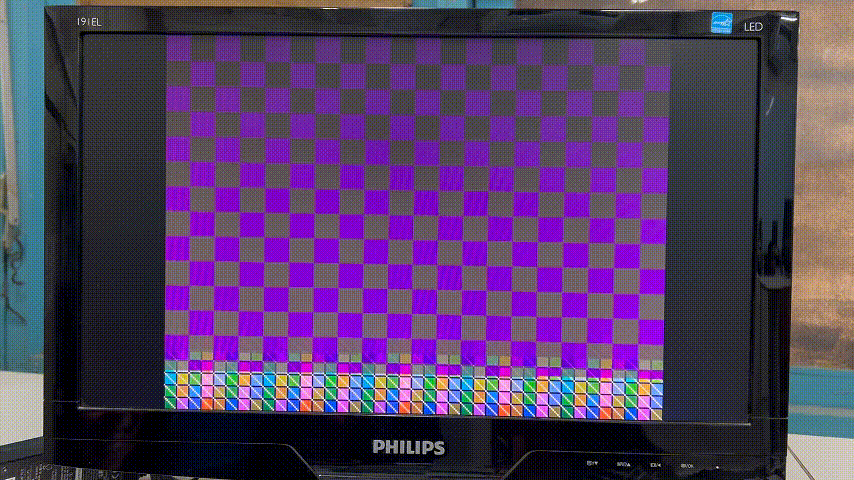
    <br>
    <figcaption>
      <i>Figura x - Testes das Instruções de Sprite.</i>
    </figcaption>
  </figure>
</div>

<br>

### 3. Rasterizador de Polígonos em Pipeline, 4 Orientações de *Flip*, `PRIOR` e Limites — Cenas 19 a 23
* **O que foi testado:**
  * As 5 primitivas geométricas (`Retângulo`, `Quadrado`, `Triângulo Equilátero`, `Isósceles` e `Escaleno`), troca dinâmica de cor (`CORPO`), transparência (`cor = 0x00`) e escalonamento contínuo a 60 FPS (`TAMPO`).
  * Matriz completa de **orientações (`flip 0..3`: Cima, Baixo, Direita e Esquerda)** para os três tipos de triângulos, rotação animada a cada 20 quadros, persistência do `flip` durante comandos `POSPO`/`TAMPO`/`CORPO` e 4.000 combinações aleatórias de `tipo x flip x id`.
  * Operação simultânea dos **16 polígonos** em órbita trigonométrica a 60 FPS e pilha concêntrica de prioridade `ID 0 > ... > ID 15` (`Cena 21`).
  * Comutação dinâmica de prioridade global entre camadas (`PRIOR = 0`: Sprites sobre Polígonos vs. `PRIOR = 1`: Polígonos sobre Sprites) (`Cena 22`).
  * Recorte nas bordas da tela sem *wrap-around* horizontal/vertical (validando o *Lookahead* de 2 pixels no pipeline de 5 estágios), tamanhos mínimos (`4x4 px`), tamanho máximo (`319x239 px`) e casos geométricos degenerados (`Largura = 0` ou `Altura = 0`).
* **Resultado Obtido:** O pipeline de 5 estágios renderizou os 16 polígonos simultâneos em movimento a **`59,70 FPS`** sem nenhum artefato visual. Além disso, a bateria documentou dois comportamentos importantes da implementação RTL atual:
  1. No **Triângulo Escaleno (`tipo = 4`)**, a orientação `flip = 2` (Direita) compartilha os mesmos vértices de `flip = 0` (ângulo reto no canto inferior esquerdo).
  2. Em **triângulos com dimensão zero (`TAMPO(0,0)`)**, os três vértices colapsam no mesmo ponto, fazendo com que as três equações de borda resultem em $e_1 = e_2 = e_3 = 0$ para qualquer coordenada $(x, y)$ e satisfaçam a condição `<= 0` na tela inteira, razão pela qual o software deve ocultar polígonos usando `ATPO(show=0)` em vez de zerar suas dimensões.

<div align="center">
  <figure>
    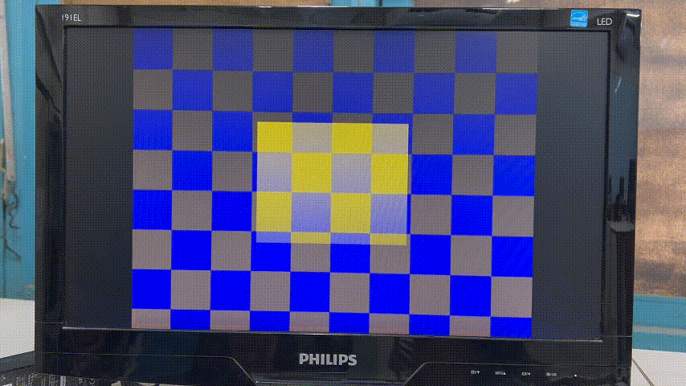
    <br>
    <figcaption>
      <i>Figura x - Testes das Instruções de Polígonos.</i>
    </figcaption>
  </figure>
</div>

<br>

## 6.2.4. Teste Integrado e Estresse Extremo (Cenas 24 e 25)

As duas últimas cenas submeteram o coprocessador à carga máxima combinada:

* **Cena 24 — Todos os Motores Simultâneos (600 Quadros a 60 FPS):**
  * Durante 600 quadros (~10 segundos), o processador ARM atualizou a cada quadro o deslocamento do plano de fundo, a órbita dos 16 polígonos com trocas periódicas de orientação, a trajetória dos 32 sprites, a prioridade entre motores e o sincronismo.
  * **Resultado:** O sistema sustentou **`59,52 FPS`** com intervalo médio cravado em **`16,800 ms`** e **zero quadros estourados** em todo o período.
* **Cena 25 — Estresse Bruto (200.000 Instruções em Rajada):**
  * Disparou **200.000 instruções válidas consecutivas** sem pausa de `VSYNC`, atingindo vazão sustentada de **`322.349 instr/s`** com `err_opcode = 0` e `wrn_param = 0`.

<div align="center">
  <figure>
    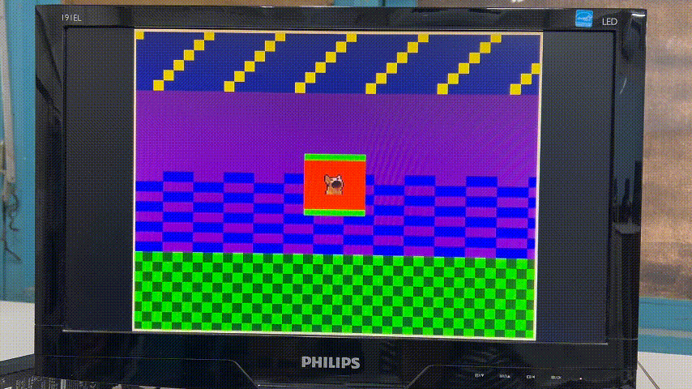
    <br>
    <figcaption>
      <i>Figura x - Teste Geral e de Estresse.</i>
    </figcaption>
  </figure>
</div>

<br>

## 6.2.5. Resultado do Teste

Ao término das 25 cenas, foram registradas **4.717.266 instruções de configuração/memória** e **8.383.369 envios totais** sem um único *timeout* de barramento:

| Função Assembly | Chamadas Executadas | Tempo Total (`ms`) | Lat. Mínima (`µs`) | Lat. Média Global* (`µs`) | Lat. Máxima (`µs`) | Vazão Média (`instr/s`) |
| :--- | :---: | :---: | :---: | :---: | :---: | :---: |
| **`btile`** | 2.581.284 | 8.240,45 | 2,90 | 3,19 | 16.798,49 | **313.246** |
| **`pospo`** | 1.797.252 | 38.510,31 | 2,90 | 21,43 | 16.899,99 | 46.669 |
| **`possp`** | 58.166 | 9.205,78 | 2,93 | 158,27 | 16.797,51 | 6.318 |
| **`atpo`** | 40.999 | 1.186,72 | 2,93 | 28,95 | 16.805,45 | 34.548 |
| **`tampo`** | 31.713 | 6.263,66 | 2,93 | 197,51 | 17.708,87 | 5.063 |
| **`bscroll`** | 30.280 | 6.064,85 | 2,94 | 200,29 | 16.799,19 | 4.993 |
| **`noop (rápido)`** | 28.207 | 355,83 | 2,89 | 12,61 | 16.567,46 | 79.271 |
| **`corpo`** | 26.956 | 457,82 | 2,92 | 16,98 | 16.798,72 | 58.879 |
| **`atsp`** | 26.843 | 437,25 | 2,92 | 16,29 | 16.801,90 | 61.390 |
| **`wrsp`** | 24.627 | 3.117,31 | 2,92 | 126,58 | 16.802,79 | 7.900 |
| **`rgsp`** | 22.588 | 247,91 | 2,93 | 10,98 | 16.691,08 | 91.115 |
| **`prior`** | 22.486 | 492,72 | 2,93 | 21,91 | 16.803,02 | 45.637 |
| **`clst`** | 21.107 | 214,42 | 2,93 | 10,16 | 16.711,58 | 98.437 |
| **`noop (vsync)`** | 7.055 | 29.209,24 | 2,93 | 4.140,22 | 17.712,40 | 242 |
| **`raw / inválido`** | 4.758 | 81,66 | 2,94 | 17,16 | 16.711,96 | 58.267 |
| **TOTAL (Sem VSYNC)** | **4.717.266** | **74.879,85** | **2,89** | **15,87** | **17.708,87** | **63.000** |

> Na tabela global acima, funções usadas dentro de laços animados sincronizados ao monitor (como `possp`, `pospo`, `bscroll` e `tampo`) apresentam média global maior (`21 µs` a `200 µs`) e máximo de `~16,8 ms` porque **incluem o tempo de bloqueio intencional** quando o processador ARM preenche as 16 posições da `FIFO` e aguarda a Unidade de Controle liberar vagas após o `VSYNC`. O histograma confirma que, das **4.717.266** instruções rápidas enviadas, **4.596.638 (97,44%)** foram executadas entre **`2,05 µs e 4,10 µs`**.

# 6.3. Testes no Jogo e Telemetria em Tempo Real

Além dos testes sintéticos de estresse, o código do jogo (`main.c` e `metricas.c`) possui medições internas para acompanhar o comportamento do sistema durante uma partida real na placa DE1-SoC. A cada segundo, o programa registra no terminal a taxa de quadros (`FPS`), o uso da CPU (`%`), o tempo gasto para processar cada quadro (sem contar a pausa de sincronismo), o tempo médio de envio de cada comando MMIO (`Cmd`), a quantidade de instruções enviadas por segundo (`Inst/s`), o número de sprites e polígonos ativos e o estado das flags do hardware (`PIO_STATUS`).

## 6.3.1. Regimes de Operação Observados

Os registros coletados durante o funcionamento do jogo mostram **três cenários distintos de carga**, conforme a tela ou ação em andamento:

| Cenário no Jogo | Momento da Execução | FPS Médio | Uso de CPU | Tempo de Quadro (`med`) | Vazão MMIO (`Inst/s`) | Comportamento do Sistema |
| :--- | :--- | :---: | :---: | :---: | :---: | :--- |
| **1. Telas Estáticas** | Menus, Seleção de Fase, Vitória, Game Over e Ranking | **59,5 – 62,2 FPS** | **0,7% – 5,0%** | `0,004 – 0,728 ms` | `63 – 600 instr/s` (`1 a 10/frame`) | O processador fica quase ocioso, enviando apenas comandos pontuais para atualizar cursores ou animações simples (`fifo_empty = 1`, `busy = 0`). |
| **2. Gameplay Ativo (Fases 1, 2 e 3)** | Movimentação do jogador, colisões, inimigos e atualização de HUD | **59,5 – 60,3 FPS** | **3,9% – 5,1%** | `0,526 – 0,731 ms` | `2.874 – 4.645 instr/s` (`47 a 77/frame`) | O jogo mantém 60 FPS estáveis; o cálculo da lógica e o envio dos comandos gráficos levam **menos de 0,75 ms** (~4,5% do tempo de um quadro). |
| **3. Transição de Tela / Mapa** | Carregamento de fase, menus ou troca de seção do mapa (`76.800 BTILE`) | **27,6 – 50,6 FPS** | **19,4% – 56,3%** | `3,70 – 20,17 ms` *(pico `max` de `176 – 248 ms`)* | `79.734 – 241.045 instr/s` (`1.326 a 8.608/frame`) | Envio intenso de escritas na memória de fundo; o tempo médio por comando cai para **`2,29 – 2,73 µs`** devido ao fluxo contínuo na `FIFO`. |

## 6.3.2. Análise dos Resultados

1. **Estabilidade Durante as Partidas (`Quadro(ms): med = 0,730 ms`):**
   * Mesmo nos trechos mais cheios da Fase 3, com até **9 sprites e 10 polígonos ativos ao mesmo tempo**, o sistema leva cerca de **`0,730 ms`** para ler o teclado, calcular a física e enviar todas as ~60 instruções de atualização para a FPGA.
   * Esse tempo ocupa **menos de 4,5% dos 16,67 ms** disponíveis em um quadro de 60 Hz, mantendo o uso do processador ARM em **5,0%** e garantindo **59,5 FPS constantes**.

2. **Tempo de Resposta aos Comandos ($\le 100\text{ ms}$):**
   * O requisito do projeto define que o jogo deve responder ao teclado em até $100\text{ ms}$. Como a *thread* de entrada (`thread_teclado_usb`) lê os eventos do teclado continuamente em paralelo ao laço principal, o atraso total entre o aperto da tecla e a exibição na tela corresponde apenas ao tempo de processamento do quadro somado a um ciclo de atualização do monitor VGA:
     $$\text{Latência de Resposta} \approx \underbrace{0,73\text{ ms}}_{\text{CPU + GPU}} + \underbrace{16,67\text{ ms}}_{\text{1 Quadro VGA (60 Hz)}} \approx \mathbf{17,4\text{ ms}} \ll 100\text{ ms}$$
   * Esse resultado fica mais de 5 vezes abaixo do limite máximo exigido.

3. **Motivo dos Picos de `max` (`176 ms` a `248 ms`):**
   * Nos momentos em que a taxa cai temporariamente para a faixa de `35 a 50 FPS` (com tempo máximo de `~176 ms` a `248 ms`), o log mostra que o envio sobe para **`80.000` a `241.000 instr/s`** e o tempo por comando cai para **`2,31 µs`**.
   * Isso acontece apenas durante as **trocas de tela ou mudanças de seção do mapa**, quando o programa envia **76.800 instruções `BTILE`** para redesenhar todo o fundo de $320 \times 240$ pixels. Como o driver aguarda a confirmação da `FIFO` a cada envio, a *thread* principal fica ocupada por cerca de `180 ms` nesse carregamento pontual e volta imediatamente aos `0,73 ms/quadro` e `59,5 FPS` logo em seguida.

4. **Monitoramento das Flags (`err` e `warn`):**
   * Durante toda a execução do jogo, a flag **`err` permaneceu em `0`**, indicando que nenhum *opcode* inválido ou comando corrompido chegou à FPGA.
   * A flag **`warn=1`** apareceu em alguns momentos pontuais durante a movimentação das entidades, sem afetar o desempenho ou o visual do jogo. Isso ocorre quando algum sprite ou polígono tem sua coordenada posicionada parcialmente fora da área de $320 \times 240$ antes de ser ocultado (`show=0`), acionando o aviso de limite `wrn_param` da Unidade de Controle.

# 6.4. Análise de Desempenho Geral

A análise conjunta dos testes de bancada e da telemetria em tempo real mostra que a divisão de tarefas entre o processador ARM (HPS) e o coprocessador na FPGA atende com folga aos requisitos de tempo real do jogo, desde que o tráfego de dados pela ponte MMIO seja bem gerenciado.

## 6.4.1. Balanço entre Processamento Gráfico (FPGA) e Barramento (ARM -> FPGA)

* **Poder de Desenho do Coprocessador:** O varredor lógico interno preenche os $76.800\text{ pixels}$ ($320 \times 240$) do *Back Buffer* em exatos $76.800$ ciclos do clock de $25\text{ MHz}$, o que leva **$3,072\text{ ms}$** por quadro. Como o monitor VGA a $60\text{ Hz}$ oferece **$16,67\text{ ms}$** por quadro, a FPGA conclui toda a composição visual em menos de 19% do tempo disponível, garantindo taxa fixa de 60 FPS e ausência de cortes na imagem graças ao *Double Buffering* sincronizado no `VSYNC`.
* **Orçamento da Ponte MMIO:** O protocolo de *handshake* de 4 fases apresenta mediana de **$2,30\text{ }\mu\text{s}$** por instrução (vazão máxima de $\sim 415.000\text{ instr/s}$ em rajada), permitindo enviar até **$\sim 6.144$ instruções por quadro** sem estourar o limite de $16,67\text{ ms}$.
* **Eficiência no Gameplay Normal:** Durante as partidas, o jogo envia em média **47 a 77 instruções por quadro** (`POSSP`, `ATSP`, `RGSP`, `POSPO`, `ATPO`, `CORPO`), consumindo apenas **$0,73\text{ ms}$** por frame (4,5% do orçamento temporal) e **5% da CPU**.

## 6.4.2. Gargalo na Movimentação Contínua da Tela Planejada Anteriormente

No planejamento inicial do projeto, a câmera do jogo deveria acompanhar continuamente a subida vertical do personagem pixel a pixel, atualizando o cenário na memória de fundo em tempo real conforme o jogador avançava.

* **Causa do Problema:** Como a memória de fundo passou a armazenar cada pixel individualmente ($320 \times 240 = 76.800\text{ posições}$) e não há barramento DMA entre a SDRAM do HPS e a FPGA, cada pixel modificado exige uma instrução `BTILE` transmitida individualmente pela ponte *Lightweight* AXI com *handshake* síncrono.
* **Impacto Medido:** Os testes mostraram que redesenhar a tela inteira ($76.800\text{ BTILE}$) leva **$182,5\text{ ms}$** (~11 quadros perdidos), enquanto redesenhar metade da tela ($38.400\text{ BTILE}$) leva cerca de **$91\text{ ms}$** (~5,5 quadros). Tentar redesenhar faixas extensas do fundo enquanto o gato se movia fazia a *thread* principal do jogo ficar presa no laço de envio da `FIFO`, derrubando a taxa de quadros para menos de 30 FPS e causando travamentos visíveis nos controles.
* **Solução Adotada:** Em vez de rolar e redesenhar o fundo continuamente a cada passo do jogador, o mapa das fases foi dividido em **seções estáticas de tela inteira** ($320 \times 240$ pixels). O fundo só é carregado na `ram_map` quando o jogador atravessa a borda superior de uma seção para a próxima. Além disso, em eventos dinâmicos dentro da mesma tela, o código substitui apenas o retângulo local onde a porta estava desenhada (pintura localizada de poucos pixels em vez de recarregar toda a tela), eliminando o travamento durante a ação.

</details>

---

<details>
<summary><h2 id="7-tecnologias-utilizadas">7. Tecnologias Utilizadas</h2></summary>

- Quartus Prime Version 25.1std.0 Build 1129 10/21/2025 SC Lite Edition  
- Placa Terasic DE1-SoC, com FPGA Intel Cyclone V <code>5CSEMA5F31C6</code> e processador ARMv7-A;  
- Linguagens:  
  - Verilog-2001;  
  - Assembly;  
  - C;  
- Monitor Philips Lcd Led 18,5 Polegadas <code>191el2sb/78</code>;  
- [Canva](https://www.canva.com/): Diagrama de Alto Nível;  
- [Claude](https://claude.ai/new): Códigos de Teste;  
- [Google Spreadsheet](https://docs.google.com/spreadsheets): Tabela de <code>Opcodes</code>;
- [Piskel](https://www.piskelapp.com/): Desenho dos Sprites e dos cenários, além de ter sido essencial para a definição das coordenadas dos elementos visuais.
- [Gimp](https://www.gimp.org/): Elaboração dos cenários.

</details>

---

<details>
<summary><h2 id="8-instalacao">8. Como compilar e Executar</h2></summary>

<details>
<summary><h3>Pré-requisitos</h3></summary>

- Possuir instalado o compilador <code>gcc</code>;
- Possuir instalado o <code>Git</code>;
- Possuir instalado o software <code>Quartus Prime</code> (com suporte à família Cyclone V);  
- Utilizar uma placa de desenvolvimento FPGA DE1-SoC com Linux embarcado no HPS;  
- Possuir um monitor conectado à placa por meio da saída VGA;  
- Cabo USB para conexão JTAG e cabo serial/UART ou Ethernet para acesso ao terminal Linux da placa.

</details>

# Passo a Passo

## 1\. Clonar o repositório

No terminal do seu computador, clone o repositório do projeto:

```sh
git clone https://github.com/AnaluzLima/development-of-a-graphics-coprocessor-and-an-embedded-game-application
```

## 2\. Compilação e Gravação na FPGA (Quartus Prime)

1. Abra o Quartus Prime;

2. Vá no menu superior em <code>File > Open Project...</code>;

3. Navegue até a pasta do projeto clonado e abra o arquivo <code>/src/coprocessador/soc_system.qpf</code>

4. Na aba lateral <code>Project Navigator</code>, localize o arquivo <code>ghrd_top.v</code>, clique nele com o botão direito e selecione a opção <code>Set as Top-Level Entity</code>;

5. Inicie a compilação completa do projeto clicando em <code>Processing > Start Compilation</code>;

   > ⚠️ O tempo médio estimado de compilação é de 8 a 12 minutos.

6. Após a conclusão bem-sucedida, conecte a placa DE1-SoC ao computador via cabo USB;

7. Abra o <code>Programmer</code> (<code>Tools > Programmer</code>), certifique-se de que o dispositivo Cyclone V foi detectado e clique em <code>Start</code> para carregar o arquivo <code>.sof</code> na FPGA.

## 3\. Transferência de Arquivos para o HPS (Linux)

1. Conecte-se ao terminal Linux da DE1-SoC (via SSH, UART/Serial ou SCP);  
2. Transfira os códigos de teste ou os arquivos do *Tomb of The Desk*, juntamente com o `libAssembly.S` para o ambiente Linux da placa:

## 4\. Compilação dos Testes no Linux

No terminal da placa DE1-SoC, dentro do diretório onde os arquivos foram colocados, compile o que deseja executar:

- **Para compilar o Teste Visual e Estresse (testeClaude.c):**

```sh
gcc -O2 -Wall -std=gnu99 testeClaude.c libAssembly.S -o testeClaude -lrt
```

- **Para compilar o Teste Interativo de Instruções (testeInstrucoes.c):**

```sh
gcc -O2 -Wall -std=gnu99 testeInstrucoes.c libAssembly.S -o testeInstrucoes -lrt
```

- **Para compilar o *Tomb of The Desk***

```sh
make
```

## 5\. Execução

Para acessar a ponte de comunicação <code>MMIO</code> (<code>/dev/mem</code>), você pode executar como superusuário (<code>root</code>).

1. Entre no modo root:

```sh
sudo su
```

2. Execute o binário desejado:  
- Para o teste visual completo:

```sh
./testeClaude
```

- Para o teste interativo manual:

```sh
./testeInstrucoes
```

- Para o *Tomb of The Desk*:

```sh
./jogo
```

</details>

---

<details>
<summary><h2 id="10-considerações-finais">10. Considerações Finais</h2></summary>
O desenvolvimento do jogo concluiu o console digital dedicado: a aplicação em C, executada no ARM da DE1-SoC, compõe toda a cena exclusivamente por meio do driver em Assembly e do coprocessador gráfico em FPGA, sem desenhar um único pixel pela CPU. O resultado é um jogo completo, com máquina de estados (abertura, menu, escolha de skin, fases, pausa, vitória, derrota e ranking), três fases com dificuldade crescente, inimigos com comportamentos distintos, pontuação por desempenho e ranking persistente.

Pelas limitações encontradas, as principais melhorias futuras são:

- **Suporte ao mouse:**  hoje o jogo é controlado apenas pelo teclado, e o enunciado também sugere o uso do mouse. (ex.: navegação nos menus e na pausa).
- **Troca de etapa mais leve:** a mudança entre as metades do mapa regrava 76.800 pixels de background via `btile`. Uma instrução em lote, DMA ou uso do tilemap com `bscroll` reduziria esse custo.
- **Carregamento de sprites em bloco:** cada padrão de sprite é enviado por 256 chamadas de `wrsp`. Uma escrita em rajada diminuiria a latência de carga das telas e fases.
- **Sincronização com o vídeo:** o laço usa `usleep(16000)`; sincronizar pelo `frame_counter()` do hardware evitaria deriva entre a lógica e o quadro VGA.
- **Ranking com nomes:** registrar iniciais do jogador (hoje só skin e pontos) e ampliar além do Top 3.
- **Mais conteúdo:** novas fases e inimigos, e um editor de mapas para criar fases sem alterar o código.
- **Limites de hardware:** o coprocessador suporta 32 sprites e 16 polígonos; ampliar esses limites permitiria cenas mais ricas sem multiplexação por metade de tela.
- **Remover o atalho `P`** (depuração) da versão final e **automatizar os testes** de latência e taxa de atualização.

</details>

---

<details>
<summary><h2 id="11-referencias-inspiracoes">11. Referências e Inspirações</h2></summary>


<h3 id="111-referencias">11.1. Referências</h3>

- ARM LIMITED (2020). Coprocessor and Arm Custom Instructions Interface for Cortex-M33. Documentação Técnica de Arquitetura ARM. COTTRELL, R. (2004). FPGA Coprocessors: Hardware IP for Software Engineers. White Paper / Artigo Técnico, Altera Corporation, High Wycombe, UK.  
- FRANCHINI, S. et al. (2005). A sliced coprocessor for native Clifford algebra operations. In IEEE International Workshop on Computer Architecture for Machine Perception (CAMP),, Palermo, Itália. IEEE.  
- HARRIS, D.; HARRIS, S. (2012). Digital Design and Computer Architecture. 2\. ed. Waltham, MA: Morgan Kaufmann / Elsevier.  
- INTEL CORPORATION / TERASIC (2014). DE1-SoC Development and Media Board User Manual. San Jose, CA: Altera / Terasic Technologies.  
- KUMARATHUNGA, D. et al. (2019). VLIW Based Runtime Reconfigurable Machine Vision Coprocessor Architecture for Edge Computing. In IEEE 30th International Conference on Application-Specific Systems, Architectures and Processors (ASAP), IEEE.  
- MAAS, E. et al. (1997). A processor-coprocessor architecture for high end video applications. In IEEE International Conference on Computer Design (ICCD), IEEE.  
- NEWHOUSE, L.; CUI, H. (2020). Minimalist GPU on an FPGA: Final Report. Relatório de Projeto, Department of Mathematics & EECS, Massachusetts Institute of Technology (MIT), Cambridge, MA.  
- PALA, D. (2017). Design and programming of a coprocessor for a RISC-V architecture. Dissertação (Mestrado em Engenharia de Computadores) – Politecnico di Torino, Turim, Itália.  
- PATTERSON, D. A.; HENNESSY, J. L. (2017). Computer Organization and Design ARM Edition: The Hardware/Software Interface. Cambridge, MA: Morgan Kaufmann / Elsevier.  
- PROJETO DE SISTEMAS DIGITAIS (2026). Otimização de Instruções e Arquitetura para FPGA DE1-SoC. Registro / Documentação do Projeto.  
- SUKHSAWAS, S.; BENKRID, K.; CROOKES, D. (2003). A reconfigurable high level FPGA-based coprocessor. In IEEE International Workshop on Computer Architectures for Machine Perception (CAMP), IEEE.  
- YANG, R.; RUDOLF, D. R.; RAGHUNATHAN, V. (2006). Flexible Pixel Compositor for Plug-and-Play Multi-Projector Displays. Relatório Técnico, University of Kentucky / Sapphire Computers, Inc.  
- YANG, S.; SCHAUMONT, P.; VERBAUWHEDE, I. (2005). Microcoded coprocessor for embedded secure biometric authentication systems. In Proceedings of the 3rd IEEE/ACM/IFIP International Conference on Hardware/Software Codesign and System Synthesis (CODES+ISSS), pp. 240-245, Jersey City, NJ. ACM/IEEE.  
- YIU, J. (2010). The Definitive Guide to the ARM Cortex-M3. 2\. ed. Burlington, MA: Newnes / Elsevier.

<h3 id="112-inspiracoes">11.2. Inspirações</h3>

- [Readme Template \- iuricode](https://github.com/iuricode/readme-template)  
- [Awesome Repo Template \- MarketingPipeline](https://github.com/MarketingPipeline/Awesome-Repo-Template)  
- [Tomb of The Mask](https://tombofthe-mask.com/)  
- [Level Devil](https://playleveldevil.com/play/)

</details>
